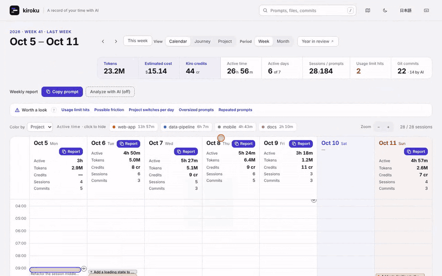
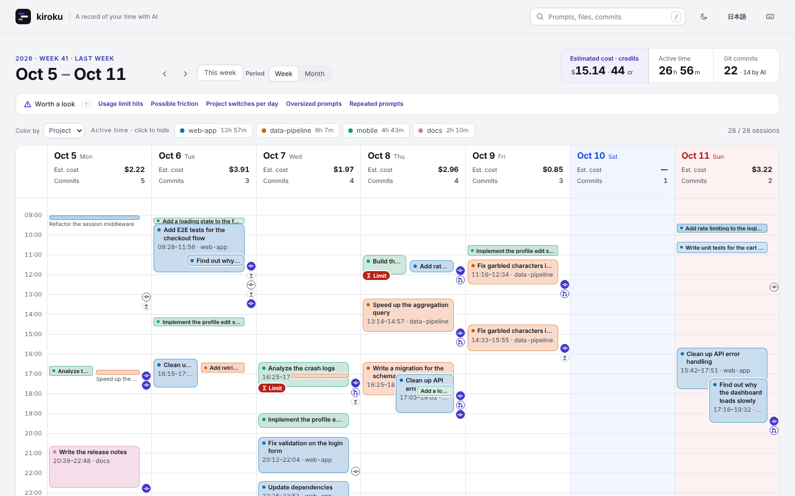
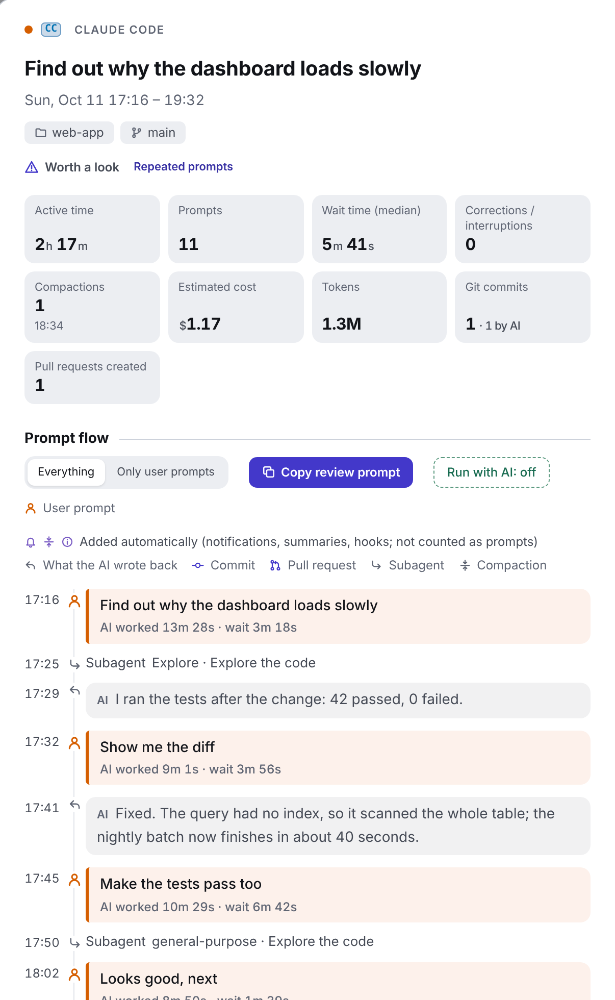
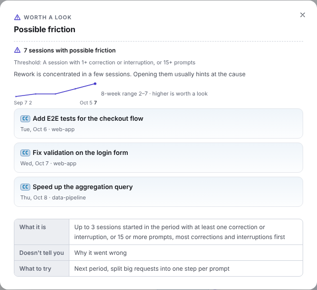
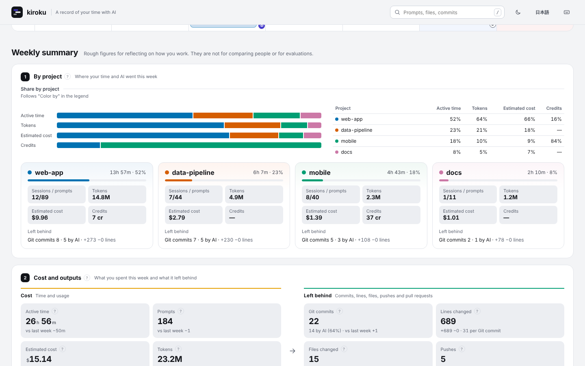

# kiroku

[](https://github.com/MichinaoShimizu/kiroku/actions/workflows/ci.yml) [](https://github.com/MichinaoShimizu/kiroku/releases) [](LICENSE) [](https://github.com/MichinaoShimizu/kiroku/actions/workflows/codeql.yml) [](https://scorecard.dev/viewer/?uri=github.com/MichinaoShimizu/kiroku) [](go.mod) [](https://github.com/MichinaoShimizu/kiroku/releases)

[English](README.md) | 日本語

**AI と積み重ねた仕事を、記録から価値へ。**

何を作り、どう働いたかを振り返り、次の AI 活用につなげる。

kiroku は、Claude Code、Kiro（IDE・CLI・Kiro Crew）、Amazon Q Developer CLI、Codex CLI のローカル履歴を 1 つにまとめます。アカウント・テレメトリ・アップロードは不要です。AI エージェントが動くのは、`kiroku serve` の「AI 分析」で実行を確認したときだけです。

**[デモを試す →](https://michinaoshimizu.github.io/kiroku/)**（ダミーデータ。ブラウザだけで動きます）

[](https://michinaoshimizu.github.io/kiroku/)

## kiroku の特長

- **どのエージェントも 1 つのカレンダーに。** Claude Code・Codex・Kiro・Amazon Q を並べて見られます。エージェントごとにダッシュボードを開く必要はありません。
- **数えるだけでなく、読めるセッション。** 何を頼み、AI が何と答え、その間にどんなコマンド・コミット・プルリクエストがあったかを、時間・トークン・費用と並べて見られます。
- **AI との働き方の変化がわかる。** 稼働時間・トークン・推定費用と、その移り変わりを、1 つのセッションから 1 か月まで確かめられます。
- **振り返りは、あなたのエージェントが書く。** 「AI 分析」が、履歴に基づくプロンプトをいつものエージェントで実行します。
- **履歴は PC の外に出ません。** バイナリ 1 つで動き、アカウントもテレメトリもありません（「AI 分析」については[プライバシー](#プライバシー)を参照）。

## インストール

```bash
curl -fsSL https://raw.githubusercontent.com/MichinaoShimizu/kiroku/main/install.sh | sh   # macOS と Linux
kiroku doctor   # 見つかった履歴と、消されそうな履歴がないかを表示
kiroku serve    # http://localhost:8484/ で画面を開く
```

インストーラーは、ダウンロードしたファイルを `checksums.txt` で確かめます。[GitHub CLI](https://cli.github.com/) があれば、ビルドの来歴（build provenance）も確かめます。Windows では [Releases](https://github.com/MichinaoShimizu/kiroku/releases) の zip を、Go があれば `go install github.com/MichinaoShimizu/kiroku@latest` を使ってください。詳しくは[ガイド](docs/guide.md#install)（英語）にあります。

> [!IMPORTANT]
> **Claude Code は、既定では 30 日より古い会話を消します。** kiroku が見せられるのは、残っている履歴だけです。`~/.claude/settings.json` に `"cleanupPeriodDays": 3650` を設定するか（[公式ドキュメント](https://code.claude.com/docs/en/settings-reference#cleanupperioddays)）、`kiroku archive on` で kiroku に圧縮した写しを残させてください（[詳しく](docs/guide.md#keep-a-copy-of-history-in-kiroku)）。

## できること

**すべてのセッションをカレンダーに。** いつ、どのプロジェクトで、何を頼んだかを週・月で表示し、日ごとの稼働時間・推定費用・Git コミットを並べます。作業の記録で、進み具合を示すものではありません。



**セッションを会話として読める。** プロンプトの流れを時刻つきで表示し、自分で打ったプロンプトと自動で入ったものを分けます。その間のコマンド・コミット・プルリクエスト・サブエージェント・中断も並べ、プロンプトごとに AI の応答を添えます。「AI 分析」で、あなたのエージェントに振り返ってもらえます（下を参照）。



**どの数字も開ける。** 上の数字や週のまとめの数字（推定費用・Git コミットなど）を押すと、日・エージェント・プロジェクト・モデルごとの内訳と、その元になったセッション・コミット・プロンプトが見られます。

**見直す候補。** 基準を超えた指標を、上の数字の下に並べます。押すと、何が起きたか、なぜ大事か、元になったセッション、8 週の推移、試すとよいことが、カレンダーを離れずに見られます。



**費用と成果を並べて。** プロジェクトごとの時間・トークン・推定費用（Claude Code・Codex・Kiro Crew の Kiro 以外のバックエンドは公開 API の料金で計算）・クレジットを、コミット数やコミットあたりの費用と並べます。週や月の途中なら、上の数字とまだ来ていない日に、前の期間と同じ費用に収める 1 日の目安を出します（予算の設定は要りません）。記録する内容はエージェントによって違います。[エージェントごとに記録されること](docs/guide.md#what-each-agent-records)はガイドにまとめています。



**全期間を検索。** プロンプト・編集したファイル・コミットを、合った箇所の抜粋つきで探せます。

画面は、ブラウザの言語が日本語なら日本語で表示されます。右上のボタン（または `--lang`）で English と日本語を切り替えられます。

## 振り返りとアドバイスは、あなたのエージェントが書く

`kiroku serve` の「AI 分析」は、この PC でいつも使っている AI エージェント（Claude Code や Codex など）でプロンプトを実行します。送るプロンプトをそのまま見せ、実行のたびに確認します（`--no-ai` を付けて起動すると切れます。保存した HTML ファイルはエージェントを動かしません）。プロンプトには kiroku が数えた事実と履歴ファイルの場所が入っているので、エージェントは実際に起きたことを読み、プロンプトと開発の仕事に詳しい専門家として、決まった形で振り返りを書きます。

| 範囲 | 場所 | 得られるもの |
|---|---|---|
| 1 つのセッション | セッションの詳細の「AI 分析」 | 要約、数字、プロンプトの評価、優先度順のアドバイス 3 つまで（時刻つきで元のプロンプトを引き、よりよいプロンプトを示す）、似た作業に使えるプロンプト集 |
| 1 週間・1 か月 | 期間の日付の下の「週報」（月の表示では「月報」）の「AI 分析」 | 週報・月報: 要約、前の期間と比べた数字、プロジェクトごとにしたことと理由、専門家の所見と次の一手。チームにそのまま共有できます |

アドバイスはよくある一般論ではなく、あなたの履歴に基づきます。どの指摘にも、根拠（数字、時刻つきのプロンプト、kiroku が数えた兆候）が書かれます。履歴に表れていれば、次のことに触れます。

- **プロンプトの書き方**: 足りなかった背景・制約・完了の条件、最初のプロンプトがはっきりしていれば要らなかった手直し
- **エージェントの使い方**: 作業の分け方と順番、結果の確かめ方、長いセッション、待ち時間
- **モデルとコンテキスト**: 作業に合ったモデルか（たとえば 1 行の質問に Opus 級のモデル）、長くなった会話、コンパクション、プロジェクトの切り替え
- **プロンプトから外に出せること**: 何度も打っている指示はスキルやプロジェクトのエージェント向けの指示に、別の役割はサブエージェントに、決まった手順はスクリプトに

ダミーの履歴から書かせた週報の抜粋（英語）:

> - **Turn the repeated check into a skill or script.** You typed "Run the full test suite and the linter, fix anything that fails, and show me the summary" 3 times in 3 sessions. Make it a skill or a project script the agent runs before each commit.
> - **Use a lighter model for quick questions.** On Thu, Aug 13 at 10:00 you asked a one-line question in a separate Opus session. A lighter model is enough for questions like this.

プロンプトは軽く保っています。報告のプロンプトには各セッションの短い要約だけが入り、エージェントは要約で足りないときにだけ履歴ファイルを開きます。各プロンプトの中身は[ガイド](docs/guide.md#reviews-and-reports-with-your-agent)にあります。

## プライバシー

- 履歴は PC の外に出ません。テレメトリも、アカウントも、AI サービスもありません（ただし `kiroku serve` の「AI 分析」で実行を確認したときは、選んだエージェントが、プロンプトと読んだ履歴をその提供元に送ることがあります。`kiroku serve --no-ai` で、エージェントの実行を切れます）。ネットワークを使うのは、kiroku 自身の新しい版を GitHub で確かめてダウンロードするときだけです。
- kiroku が履歴から書くファイルは、あなたしか読めません。`kiroku serve` は `127.0.0.1` で待ち受け、鍵を持つブラウザにだけ開きます。
- HTML には、プロンプト・AI の応答・ファイルのパス・コミットメッセージがそのまま入っています。人に渡す前に中身を確かめてください。
- 振り返りと報告のプロンプトは、PC 上の AI エージェントに履歴ファイルの場所を教え、エージェントはそれを読みます。履歴を任せられるエージェントを使ってください。

詳しいことと、リリースの確かめ方は [SECURITY.md](SECURITY.md) にあります。

## 使い方

```bash
kiroku serve              # http://localhost:8484/ の画面。新しい履歴が入るたびに更新
kiroku open               # 別のブラウザで開く（最初に一度 serve の鍵が要る）
kiroku autostart on       # ログインのたびに kiroku serve を起動（macOS と Linux）
kiroku stats --week last  # 先週の時間・トークン・費用・コミットを、エージェント・モデル・プロジェクト別に端末に 1 画面で
kiroku html --week last   # 先週だけを 1 つの HTML に書き出して、人に見せる
kiroku update             # 最新の版に更新
kiroku help               # すべてのコマンド（オプションは "kiroku <command> --help"）
```

画面の見方、すべての指標、読む履歴、すべてのオプション、[アンインストールの方法](docs/guide.md#uninstall)は[ガイド](docs/guide.md)に、版の番号が約束することは[互換性](docs/compatibility.md)にあります（どちらも英語）。

## 貢献

kiroku が役に立ったら、⭐ を付けてもらえると、ほかの人が見つけやすくなります。Issue とプルリクエストは英語でも日本語でも歓迎します。[CONTRIBUTING.md](CONTRIBUTING.md) を読んでください。脆弱性は [SECURITY.md](SECURITY.md) の方法で、非公開で知らせてください。

## ライセンス

[MIT](LICENSE)
