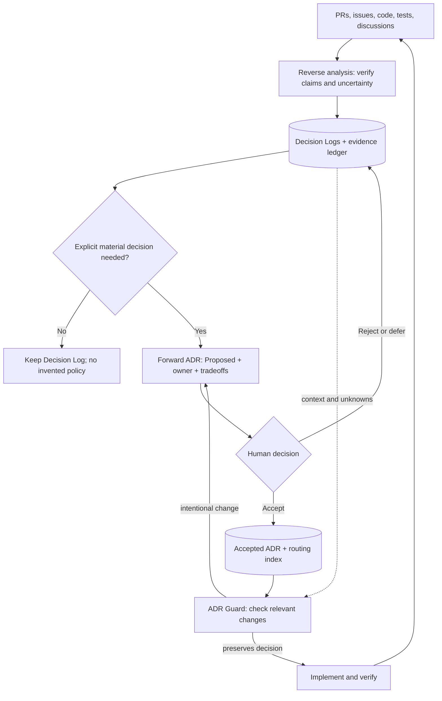
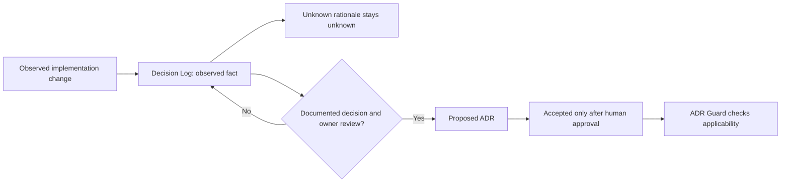

# Decision Continuity: Decision Logs, ADR Guard, and Forward ADR

Decision Continuity keeps **what happened** separate from **what has been deliberately decided**. It is repository-agnostic and does not require any particular programming language or agent.

## Two distinct records

| | Decision Log | Architecture Decision Record (ADR) |
|---|---|---|
| Question | What happened, what was explored, and what remains unknown? | What should we do, why, and under whose authority? |
| Evidence | PRs, code, tests, reviews, alternatives explored, reversals | Explicit proposed or approved choice, alternatives, consequences, owner |
| Lifecycle | Historical or ongoing; may remain uncertain | Proposed, Accepted, Rejected, Superseded, Deprecated |
| Authority | Context and evidence, **not a rule** | Only an applicable **Accepted** decision constrains future changes |
| Maintenance | Append findings and corrections with provenance | New ADR for material changed decisions; preserve historical rationale |

A merged PR proves a change occurred, **not** that an architectural policy was formally approved. An observed implementation is never automatically promoted to an Accepted ADR. A Proposed ADR is not a constraint.

## End-to-end workflow

The ADR index routes by path **and meaning**; the Decision Log index provides historical evidence. ADR Guard can consult both but must distinguish the authority of an Accepted ADR from the informational value of a Decision Log.

## Decision authority and uncertainty

**Uncertainty Preservation** means keeping confirmed behavior, historical rationale, test evidence, and unresolved questions on separate axes. A later explicit ADR does not rewrite why a historical change occurred.

## Minimal artifact contract

- **Decision Log**: stable ID, topic/scope, historical observations, links to source evidence, historical date if verified (otherwise Unknown), confidence labels (Documented/Observed/Inferred/Unknown), reversals, open questions and verification limits. A Decision Log does not need a fictitious decision owner, ADR supersession status or rejected alternatives. Its historical date must not be confused with ADR approval.
- **ADR**: stable ID, Status, Date (or Unknown), Scope, owner, Context, proposed or accepted Decision, actual Alternatives, Consequences, Verification, Related/Supersedes links. Only an authorized owner can accept or reject.
- **ADR index**: only actual ADRs and their applicability, status and supersession. A legacy compatibility redirect is not an ADR entry.
- **Decision Log index**: historical records, topic/path hints, evidence status and references to related ADRs where genuinely established.

## Agent responsibilities

1. **Reverse ADR / reverse design analysis** reconstructs Decision Logs by default. It may identify *candidate* decisions, but must not assert acceptance or create binding policy from code alone.
2. **ADR Guard** reads the ADR index for relevant Accepted decisions, and consults Decision Logs for context or uncertainty. Proposed ADRs are review inputs, not enforced rules.
3. **Forward ADR** drafts material new decisions with alternatives and consequences. Human review determines acceptance. Intentional departures create a new ADR and reciprocal supersession links.
4. **Periodic audit** checks links, routing, evidence confidence, supersession, drift and missing review. Routine changes need no ceremonial ADR.

## Adoption and migration

1. Inventory existing records; classify historical observations as Decision Logs unless formal decision authority is evidenced.
2. Preserve historical source links and stable legacy URLs through compatibility redirects; never silently renumber old records.
3. Create separate Decision Log and ADR indexes. Move old evidence to Decision Logs without claiming a retrospective ADR was Accepted.
4. Update agent instructions and PR review conventions to check Accepted ADRs, then consult Decision Logs when useful.
5. Record new durable decisions as Proposed ADRs and request explicit owner review before acceptance.

## Success criteria and limitations

Useful signals include fewer accidental reversals of accepted constraints, faster understanding of historical design, and fewer false-positive governance warnings. These are hypotheses, not measured outcomes. Neither a merged PR nor a test file alone proves approval or a passing test. Routing indexes may miss semantic dependencies; privacy, identity, compatibility and measurement changes require proportionate cross-cutting review.

## kiroku reference implementation

See the [ADR index](README.md), [Decision Log index](../decision-log/README.md), [Reverse ADR](../../.claude/skills/reverse-adr/SKILL.md), [ADR Guard](../../.claude/skills/adr-guard/SKILL.md) and [Forward ADR](../../.claude/skills/forward-adr/SKILL.md).

## Scenario validation

The [Decision Continuity scenario matrix](../../tools/decision-continuity/scenario-tests.md) contains twelve static contract checks for historical evidence, unknown rationale, Proposed versus Accepted decisions, ADR Guard applicability, reversals, test evidence and legacy references. These are documentation-level checks; the first live-agent run is in [scenario-results-2026-10-11.md](../../tools/decision-continuity/scenario-results-2026-10-11.md).
