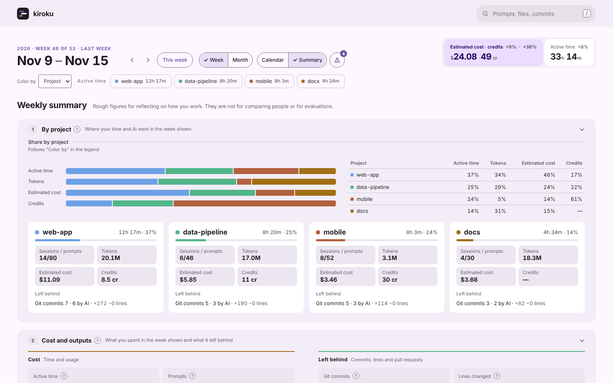

# kiroku guide

This guide supplements the [README](../README.md). It covers installation and commands in detail, how to read the view, metric definitions, which histories are read, and options.

## Install

### macOS and Linux (recommended)

```bash
curl -fsSL https://raw.githubusercontent.com/MichinaoShimizu/kiroku/main/install.sh | sh
```

This downloads the file for your OS and CPU (Intel / Apple Silicon and ARM) from [Releases](https://github.com/MichinaoShimizu/kiroku/releases), verifies it with `checksums.txt`, and places it in `/usr/local/bin` (or `~/.local/bin` if that is not writable). You can set the version and install location with environment variables.

```bash
curl -fsSL https://raw.githubusercontent.com/MichinaoShimizu/kiroku/main/install.sh | KIROKU_VERSION=v0.1.7 KIROKU_INSTALL_DIR=~/bin sh
```

| Variable | Meaning |
| --- | --- |
| `KIROKU_VERSION` | The version to install (e.g. `v0.1.7`). The latest if not set |
| `KIROKU_INSTALL_DIR` | Where to place `kiroku`. `/usr/local/bin` if not set (`~/.local/bin` if that is not writable) |
| `KIROKU_SKIP_ATTESTATION=1` | Do not check the build provenance with `gh`, even if it is installed (also for `kiroku update` in a build from your organization's repository) |
| `KIROKU_REQUIRE_ATTESTATION=1` | Require the build provenance check: stop instead of installing when `gh` is missing or not logged in, cannot reach GitHub, or the version is older than v0.12.0 |

`install.sh` checks each download against `checksums.txt` and, when the [GitHub CLI](https://cli.github.com/) (`gh`) is installed, its build provenance (see [Verifying a release](../SECURITY.md#verifying-a-release)). You can also check a file you downloaded yourself:

```bash
gh attestation verify kiroku_<version>_darwin_arm64.tar.gz --repo MichinaoShimizu/kiroku
```

### Windows

Download `kiroku_<version>_windows_<amd64 or arm64>.zip` from [Releases](https://github.com/MichinaoShimizu/kiroku/releases) and extract it.

### Go

Go 1.26 or later is required.

```bash
go install github.com/MichinaoShimizu/kiroku@latest
```

> On macOS, opening a `kiroku` downloaded with a browser may show "“kiroku” Not Opened" (because it is not notarized by Apple). `install.sh` and `go install` do not trigger this warning. If you downloaded it with a browser, run `xattr -d com.apple.quarantine ./kiroku`, or open it with "Open Anyway" in System Settings → Privacy & Security.

### With the GitHub CLI

Each release also has the binary on its own: `kiroku-darwin-arm64`, `kiroku-darwin-amd64`, `kiroku-linux-amd64`, `kiroku-linux-arm64`, `kiroku-windows-amd64.exe` and `kiroku-windows-arm64.exe`. With the [GitHub CLI](https://cli.github.com/), one command downloads it to a place you choose (files `gh` downloads get no quarantine attribute on macOS):

```bash
gh release download -R MichinaoShimizu/kiroku -p kiroku-darwin-arm64 -O ~/bin/kiroku.new \
  && gh attestation verify ~/bin/kiroku.new --repo MichinaoShimizu/kiroku \
     --signer-workflow MichinaoShimizu/kiroku/.github/workflows/release.yml --deny-self-hosted-runners \
  && chmod +x ~/bin/kiroku.new && mv ~/bin/kiroku.new ~/bin/kiroku
```

This checks the file's build provenance (made by `release.yml` on a GitHub-hosted runner) before it replaces anything in `~/bin`. If the check fails, nothing is replaced; delete `~/bin/kiroku.new` before you try again (`gh release download` doesn't overwrite a file). The binaries are also listed in `checksums.txt`, like the archives.

### Inside an organization (a private repository)

To hand kiroku out from your organization's own GitHub repository, private or internal, push this repository there under any name and push a `v*` tag: `release.yml` builds and publishes the release in that repository. A build made in any repository other than `MichinaoShimizu/kiroku` remembers where it was built (`HOST/OWNER/REPO`), and its `kiroku update` and the update check of `kiroku serve --check` ask that repository through the GitHub CLI and its login, so they reach a private repository. kiroku keeps no token of its own, and verifies the download with `checksums.txt` as usual.

For the people who use it:

```bash
gh auth login                                                   # once
gh release download -R your-org/your-repo -p kiroku-darwin-arm64 -O ~/bin/kiroku.new \
  && gh attestation verify ~/bin/kiroku.new --repo your-org/your-repo \
     --signer-workflow your-org/your-repo/.github/workflows/release.yml --deny-self-hosted-runners \
  && chmod +x ~/bin/kiroku.new && mv ~/bin/kiroku.new ~/bin/kiroku
kiroku serve
kiroku update                                                   # later: updates from your-org/your-repo
```

On Windows, download `kiroku-windows-amd64.exe` (or `-arm64.exe`) the same way to a new file such as `-O "$env:LOCALAPPDATA\Programs\kiroku\kiroku.new.exe"`, check it with the same `gh attestation verify` line, then rename it to `kiroku.exe` and add that folder to your `PATH`.

- `kiroku update` there needs `gh` installed and logged in with access to the repository (with SAML single sign-on, authorize the login for the organization). Without them it stops and says what to do
- Before it replaces anything, `kiroku update` there also checks the build provenance with `gh attestation verify` (made by that repository's `release.yml` on a GitHub-hosted runner), as `install.sh` does: it stops if the provenance doesn't match, warns if `gh` is too old or can't reach the host, and follows `KIROKU_REQUIRE_ATTESTATION=1` and `KIROKU_SKIP_ATTESTATION=1`. On GitHub Enterprise Server without artifact attestations, set `KIROKU_SKIP_ATTESTATION=1`; it never falls back to the public repository
- In that repository you only need `release.yml` (and `ci.yml` if you like). The other workflows (`pages.yml`, `prices.yml`, `upstream.yml`, `scorecard.yml`, `codeql.yml`, `tag.yml`, `fuzz.yml`) are for this public repository and can be deleted. Your enterprise's Actions policy must allow the actions `release.yml` uses, and build provenance for a private repository needs GitHub Enterprise Cloud
- The links at the bottom of the view (GitHub, and the release of the running version) point to that repository too
- To put the demo page (dummy data, no one's history) on an internal web server, build it with `KIROKU_REPO=github.com/your-org/your-repo sh tools/screenshots/run.sh --html index.html` (needs Go, Python 3 and git). Its dummy data covers the five weeks up to the day it was built. Never put a view of real history on a shared server
- Take each new release of `MichinaoShimizu/kiroku` in soon: only the latest release is supported, and security fixes go there
- `tools/reproduce.sh` checks releases of `MichinaoShimizu/kiroku`. A build from your repository embeds its name, so it differs from the public binary of the same version

## Commands

| Command | Description |
|---|---|
| `kiroku serve [ADDR]` | Serves the view at `http://localhost:8484/` and keeps it up to date (see the notes below the table). Change the port with, for example, `kiroku serve :8485` (a bare port still listens on `127.0.0.1` only). Only browsers that have its key can open the view (see "[The key of kiroku serve](#the-key-of-kiroku-serve)"); the browser it opens gets the key. If `kiroku serve` is already running at that address, running it again opens the running view in your browser with its key (with `--no-open`, it only prints the address). Press Ctrl+C to quit |
| `kiroku serve --check` | Checks your setup in one go and only reads (see the notes below the table). Run it right after installing, or when something you expect is missing from the view. `kiroku serve --check --report` prints only a short block for a bug report (kiroku --version, OS, and per agent the number of sessions, newest version seen, unreadable lines and unknown kinds with counts; no paths, project names, IDs or content) for you to review and paste into a GitHub issue yourself; kiroku sends nothing |
| `kiroku serve --archive [on\|off]` | Keeps compressed copies of history that agents delete automatically (Claude Code, Kiro Crew) in kiroku's own folder (see "[Keep a copy of history in kiroku](#keep-a-copy-of-history-in-kiroku)"). With no argument, shows the status (on or off, location, number and size of files) |
| `kiroku --version` | Prints the version (also on the first line of `kiroku help`) |
| `kiroku update` | Downloads the latest release for the same OS and CPU from GitHub Releases, verifies it with `checksums.txt`, and replaces itself. In a terminal it shows how much of the download has arrived. In a location you cannot write to (such as `/usr/local/bin`), run `sudo kiroku update`. kiroku installed with `go install` or built from source (version `dev`) is not replaced unless you pass `--force`, so update it with `go install …@latest`. `--to v1.2.3` installs a chosen version (only names such as `v1.2.3` or `v1.2.3-rc.1` are accepted); going back to an older version than the one running also needs `--force`. v0.1.1 and earlier have no `update`, so reinstall once with `install.sh` or from Releases. A kiroku built in your organization's own repository updates from there with the GitHub CLI (see [Inside an organization](#inside-an-organization-a-private-repository)) |

`kiroku help` lists commands; `kiroku serve --help`, `kiroku serve --check --help`, `kiroku serve --archive --help` and `kiroku update --help` show their options.

kiroku has three commands: `serve`, `update` and `help`. `serve` also checks your setup (`--check`) and keeps copies of history (`--archive`), each chosen with its first flag. kiroku 5.0 removed the older commands: `doctor`, `archive` and `version` stop with a message naming `kiroku serve --check`, `kiroku serve --archive` and `kiroku --version`. `open` and `html` are gone with no replacement: run `kiroku serve` (again, if it is already running) to open the view; kiroku no longer writes the view to a file. `autostart` only removes a login item that kiroku 4 registered (see [Uninstall](#uninstall)).

`kiroku serve`:

- It answers right away. While it reads your history for the first time (which can take a while with a lot of history or many git repositories), the page shows "Reading your history…" with each agent as it is read (its number of sessions and how long it took), and switches to the view when it is done. The terminal shows how many sessions each agent had, how long each one took, and the total
- If the port is already in use, it stops at once without reading history
- Every few seconds it checks the history folders for changes (file names, sizes and modification times only) and reloads once writing settles: when changes stop for 10 seconds, and within 60 seconds at most even if an agent keeps writing
- New history appears while the week or month you are viewing and the selected session stay as they are, and `LIVE` is shown at the top left

`kiroku serve --check`:

- It checks which histories were found (sessions and the oldest date for each agent, and where it looked), whether an agent will delete old history (Claude Code on its 30-day default) and which settings file to change, whether `kiroku serve --archive` is on, whether git is found, whether a login item from kiroku 4's `autostart` is still there (run `kiroku autostart` to remove it), which kiroku is running, and whether a newer kiroku is out
- For a newer kiroku it asks GitHub Releases while it reads history; `--no-update-check` skips this, and builds from source are not checked
- Agents with no history yet are summed up in one line, so the lines that ask you to do something stay in view; `--all` lists each of them with the place kiroku looks
- If another kiroku comes first in your `PATH`, so that `kiroku` runs that one instead, it says so
- Under "Format check" it shows, per agent, the newest agent version seen in history, lines that couldn't be read and record kinds kiroku doesn't know, with counts (see [How histories are read](sources.md#format-check)); unknown kinds can mean the agent changed its history format
- It ends with what to run next, including `kiroku update` when a newer release exists

The old forms `kiroku --serve`, `--json`, `-o` and `--weekly` / `--monthly` have been removed; kiroku names the command to use instead.

## View

- Today is marked quietly: a "Today" badge, its date in the accent color (underlined in the month calendar) and a very light background on its column in the week calendar, with no outline around the day.
- The vertical week calendar shows sessions as bars. Each bar is filled with a tint of its Color by color (agent or project) and has a stripe of that color on its left edge; the more messages per minute, the stronger the tint (from about a fifth to two fifths of the color), and sessions that overlap in time are placed side by side. Short bars show their name in smaller type, and bars too short for that show it just below when there is room. In narrow bars, names wrap between words and are shortened with "…"; a bar too narrow for the first word (or about 4 letters) shows its start time instead, or only its color when even that does not fit. Hover or click it for the name
- Choose **Week** or **Month** in the **Period** group at the top. Click a date, or "W##" on the left of the month calendar, to go to that week in the week calendar
  - Every number in the calendar and the band above it carries a unit, in English also in the Japanese view: "5 commits" (1 commit), "44 credits" (1 credit), "12M tokens", "$2.22", "3h", "4h 50m". On a phone, the month calendar puts the unit on the line under the number rather than leave it out
  - Figures in the legend row picks what the calendar writes for each day: estimated cost (the default), Kiro credits, tokens or active time, among those with records in the period; the choice is remembered and also sets the month calendar's shade.
- Each day heading of the week calendar shows its Git commits first, with a commit mark, then its usage and active time, such as "4 commits  $4.29  5h 9m" (the commit names are in the tooltip), so a day with much cost and few commits stands out; in a narrow column the figures wrap, each number staying with its unit. The commit count is in the same neutral color as the other figures (more commits is not better by itself). The month calendar shows each day's commits ("2 commits") above its usage, with the same usage as the shade of the day; the column on its left shows each week's usage, and every day's full figures are in its tooltip
  - Usage is the estimated cost; tokens when no model used in the week or month shown is in the price table; credits when it has no tokens
  - Active time shows as the length of the bars in the week calendar, and as the shading in the month calendar, where a thin bar in each day splits its active time by what Color by picks (agent or project) and follows hidden legend items and search (days with nothing left are dimmed). The week totals in the month calendar count only that month's days (the whole week is in the tooltip). Pressing a day opens its week scrolled to that day, with the day highlighted. Closing session details after moving with ← → returns to the last session read, and "This week / This month" (`T`) resets both the week and the month. ‹ stops at the first week or month with records, and a month with no records says so. Point at a day or week for its active time, sessions, tokens, estimated cost and credits
- The calendar describes recorded activity, not progress, completion or productivity
- Above the calendar, the figures for deciding what to do next (see the metrics table): what you used (what it left behind, such as Git commits, lines changed and pull requests, is in each calendar day and the summary's Output panel and card, not here)
  - On a tinted background: usage (estimated cost and Kiro credits side by side in one box, such as "$37.32 · 80 credits"; tokens instead of the cost when no model used is in the price table), A day to match last week while the week is in progress, and Month-end (estimate) in the month view while the month is in progress (in its place: the month view shows where the month is heading instead of a day's budget). While you look at the current week, Month-end credits shows where this month's Kiro credits are heading (credits are a monthly allowance); pressing it opens the month's breakdown without leaving the week. A box that shows both cost and credits opens the cost's breakdown, which links to the credits' breakdown
  - Then Active time
  - Prompts (with sessions) and usage limit hits are in the summary and open the same breakdowns from there; limit hits are also in "Worth a look". Active days are in the Active time breakdown
  - Items with no records are not shown; when the figures don't fit next to the period's name, they move to their own row; except on phones they always stay in that one row, set smaller when the window is narrower (a value that still doesn't fit ends with … and is in full in its tooltip and breakdown). All figures share one plain style
  - The change from the previous week or month in percent (such as "−22% vs last week") is not in the band: press a figure to see it next to the value in its breakdown; while the period is in progress it is compared with the same days of the previous one. When your history starts inside the previous period, there is no comparison, since the missing days would count as zero. No color marks it good or bad
- Click a key figure, or any figure in the summary, to open its breakdown in a dialog. What the metric counts is right under the figure; the finer points and what it doesn't tell you are at the end:
  - Most figures: by day, by agent, by project and, for tokens and estimated cost, by model, then the top sessions (press one to open its details). The day, agent, project and model rows come from the same totals as the figure, so they add up to it; the session figures cover each whole session, including any part outside the period
  - The month-end estimates show how they are worked out (so far ÷ days so far × days in the month), with the days still to come drawn as hatched bars at the current pace. They also give a 3σ range (about 99.7%) for the cost, credits and tokens, from how much the finished days varied (also in the figure's tooltip and the summary; in the by-day chart, dotted lines show the range for each day still to come). The by-day chart also draws a trend line, a straight line fitted to the finished days (least squares) and extended to the end of the month, and the breakdown gives the month-end if that trend continues. Days are neither independent nor normally distributed, so the range is a rough guide, and its low end never goes below what is already used
  - Usage limit hits and compactions are split by agent and by project and list each one with its session (and, for limit hits, the reset time)
  - Git commits are split by project, by whether AI made them and by which agent ran them, with the list of commits
  - The other figures in the panels: commits, pushes and pull requests list each one; focus blocks, oversized prompts and the session figures list the blocks, prompts or sessions behind them; wait time is split by how long you took to reply; and ratios such as cost per prompt show how they are worked out
- The period is written like "Sep 28 – Oct 4" or "October 2026" ("9月28日 – 10月4日" or "2026年10月" in Japanese), and the line above it says "This week", "Last week", "This month" or "Last month" when that is what you are looking at. ‹ › (or ← →) move to the previous or next week or month. You can't move past the current week or month; "This week" / "This month" brings you back to it. A period with no records is named by its week or month, such as "Week of Sep 28"
- Each day in the calendar shows its own figures, both its cost figure (the one picked in Figures: estimated cost, Kiro credits or tokens) and its active time: the commits, then "$2.86  5h 9m", in the day headings of the week calendar, and the two on two lines in each day and week total of the month calendar. Point at a bar, band or point in any chart (or touch it) to see the values for that day or item
- "Worth a look" is the set of metrics that crossed a threshold. The small warning triangle next to a metric's name in the summary marks each of them; press it to open it in a dialog in the middle of the screen, without leaving where you are: what was observed, why it matters, its 13-week trend, why it was flagged, the related sessions (press one to open its details), the threshold, and what the metric is, what it doesn't tell you and what to try. `Esc`, the × in its top-right corner or a click outside the dialog returns to what you pressed
- "Color by" Project / Agent is the selector at the start of the legend (Project by default). The legend belongs to the calendar and is not shown in the summary. The numbers in the legend are active time, split between sessions that ran at the same time like in "Where it went"; click an item to show or hide it. Active time, tokens and credits can't be split that way, so while items are hidden the key figures at the top and those under each date stay totals for all sessions and are shown in gray, with a note above the calendar. On a wide window and on a phone the legend stays in one row; when it doesn't fit, scroll it sideways: while there is more to the right, the right edge fades and shows how many items are out of view, such as "+3 ›" (press it to scroll; with the keyboard, Tab reaches every item). In the week calendar, each week picks the height of an hour (44px, or 36px when needed) that fits its working hours, from the morning start to the latest end, in the calendar
- Click a bar to show its details. On wide screens the left column is the prompt flow with times, and the right column has, from the top, what you can do (the resume command and "Copy prompt" for a review), the key numbers (active time, prompts, wait time, cost and tokens) and the rest (what was left behind: commits, pull requests, files edited by AI, each path a link to the commit on the remote when there is one; subagents; and, at the end, the history file, models used and tools used). On narrow screens the same parts come in the order: what you can do, the key numbers, the prompt flow, the rest. The keyboard (`Tab`) goes through them in that order on any width
  - When the session is behind a metric flagged in "Worth a look" for the period shown, those metrics are listed under the title; press one to open the same dialog
  - The prompt flow reads like a chat, in time order, in the shapes of a messaging app on the view's dark background: your prompts are bubbles in kiroku's purple with dark text on the right, the AI's replies are dark gray bubbles with light text on the left next to a round robot mark, each bubble with a small tail, and the time sits small beside the bubble's bottom edge (left of yours, right of the AI's) with the copy button above it. What happened between them (commits, pull requests created, usage limit hits with the reset time the message gave, interruptions, compactions, notes and subagents starting) is a dark label with white text in the middle (red for limits and interruptions). Opening a commit from the flow and pressing back returns to where you were reading
  - Each of your prompts and each AI reply has a copy button (faint until you point at it) that copies its text as recorded, to reuse it. A long prompt or reply the view cut is copied in full
  - The copy button next to **Prompt flow** copies the whole conversation, prompts and replies in order, as Markdown, to hand the work to another agent or paste it into a PR or a note
  - **Full screen** next to it (or `F`) shows only the prompt flow across the whole window, for reading a long conversation; `Esc` or the button again returns to the details. It stays on while you move to other sessions
- ‹ › at the top right of the details (or `←` `→`) open the previous or next session in time order, among the sessions that match the search and agent filter; the calendar follows to that session's week or month, and the details open at the start of its prompt flow. `↑` `↓`, `PageUp` `PageDown`, `Home` `End` and `Space` scroll the details
  - Each prompt shows how long the AI worked (from the prompt to the AI's last activity before the next prompt) and how long until you replied ("you replied after", from there to the next prompt), under the AI's reply when there is one (under the prompt otherwise), and a break of more than 30 minutes is a divider like "13:50–15:20: 1h 30m gap" (both are estimates from the history's timestamps; time while a subagent was running is not counted as a wait)
  - Prompts that look like corrections (guessed from the wording) get a dashed border and a "Correction?" tag. Slash commands you typed (such as `/review`) and `!` shell commands count as prompts and get a "Command" or "Shell" tag in their own color
  - Things that entered the conversation without you typing them (background task notifications, `<system-reminder>`, hook and command output, automatic conversation summaries, instructions sent by another agent or a schedule, the expanded text of a slash command, the steering rules and environment context older Kiro IDE versions add to your message and so on) are not counted as prompts and appear in the flow in another color, labeled with their kind
  - The AI's reply follows each prompt, with its own time, so a session reads as the conversation it was: the last thing the AI wrote back to you in that turn, in its own words, not its thinking, its tool calls or their output. The view first loads the first 160 characters (all of it when no more than 20 more would be cut), and "Load the full reply" reads it to the end. A turn where the AI only ran tools, or whose words the agent does not record, has no reply line
  - The flow shows 30 prompts first, and "Show N more prompts" shows the rest. A long prompt opens with "Show all", or "Read more (N characters)" when the prompt was cut. The view first loads the first 400 characters of each prompt (all of it when no more than 20 more would be cut), and "Load the full prompt" reads it to the end
  - "Copy prompt" under Session review copies a prompt to paste into an AI agent (such as Claude Code or Codex), asking it to review the session with advice on how you prompted and used the agent. See [Reviews and reports with your agent](#reviews-and-reports-with-your-agent)
  - A turn where the AI worked but wrote no reply shows how long it worked on the AI side, marked "no text reply"
- In the week calendar, weekday hours outside 9:00–18:00 have a slightly darker background, so work early in the morning or late at night stands out; Saturday and Sunday share one neutral background, the same as the hours outside 9:00–18:00 (no red or blue for the weekend days). The month calendar's shade of each day is a neutral gray-blue, so it is never mistaken for an agent's color. It comes in the same steps as its legend (Less … More): a day without records is unshaded, and a day with records takes one of four steps by its share of the month's highest day, so you can match any day to the legend
- In the week calendar, days with commits show commit marks on the right edge at their times (they don't overlap session bars; a commit mark is filled when run by AI; touch one to see its short hash; the number under the date is that day's commit count). When five or more commit, push and pull request marks fall within a few minutes of each other, the first two are shown with a "+N" mark under them; press it to lay out all of that day's marks, and press "−" to fold them again. Click a mark to see the commit details (subject, message body, project, branch, hash, lines added and removed per file changed, the session that made the commit, and a `git show` command). Session details list the commits made during that session
- The same right edge also shows pushes and pull requests. Pushes are read from your local `git reflog` of remote-tracking branches ("update by push"), so only pushes made from this computer appear, and only as far back as git keeps its reflog (90 days by default). Pull requests appear only when an agent created one and its result was recorded (`gh pr create` or GitHub tools in Claude Code); kiroku never asks GitHub. Both also appear in a session's prompt flow. Click a push (on the calendar or in the prompt flow) to see where it went, when, the commits it sent (each opens its commit details; up to the latest 50), the session running at the time and a `git log` command for the same range. Click a pull request to see its link, when it was created, the session that created it and the pushes and commits in that session before it (kiroku never asks GitHub, so the title, status and reviews are not shown). A commit's details show the push that sent it
- Anything that can be a link is a link
  - Git commits and files changed: if the remote (`origin`) is GitHub, GitLab, Bitbucket or similar, they open the page for that commit or file
  - A session's "Files edited by AI": a file changed by a commit made during that session opens the page for that file as of that commit
  - A session's "Pull requests created": opens pull requests created by AI (URLs that appeared in the results of `gh pr create` or GitHub tools)
  - A session's "History file" (at the end of session details): opens the original history of that session. "Open" saves it from the view (only history files of loaded sessions, inside the folders kiroku reads history from or `kiroku serve --archive`'s folder, are served, and only to the view on your machine). SQLite histories cannot be opened, so you can only copy the path
- The page shows either the calendar or the weekly or monthly summary: switch with View "Calendar | Summary" next to Week | Month (or `V`). The page always opens on this week's calendar; kiroku doesn't remember the view or Week | Month from the last time. Only the page scrolls: nothing is fixed, the top scrolls away, and the week calendar shows the whole day with no scroll of its own. 0:00–7:00 is folded at the top, at a quarter of the height as a shaded band, so the working hours fit the first screen; in a week with sessions in those hours it starts unfolded, so that work isn't squeezed. "0–7h" at the top of the hours unfolds or folds it, and kiroku remembers the choice. The day headings stick under the page header while you scroll, so you always see which day is which; on narrow windows the calendar scrolls sideways and the headings follow it. When you open this week and its work starts further down, the page opens scrolled to that hour (scroll up for the figures; not in the demo). Data sources and the footer (when the page was made, the version and a link to GitHub) are at the bottom in both views.
- The summary is one page of cards (see [Weekly and monthly summary](#weekly-and-monthly-summary)). "Breakdown" starts closed, and the view remembers whether you opened it. Press a figure's value to open its breakdown, or its "?" for what it means
  - Worth a look: a metric that crossed a threshold has a small warning triangle next to its name in the summary; press it to open its dialog. Its 13-week trend (13 months in month view), the same span as the summary charts, starts at the first period with records, labels that period and the one shown with their values, and says whether higher or lower is worth a look. A metric is flagged by a fixed threshold, shown right under the headline in the dialog ("Threshold: 1+ hit"), not by being high or low within its trend. To see whether something you tried worked, check the trend in later periods
  - At the bottom, "Data sources" (history read, the newest agent version seen and record kinds kiroku doesn't know, retention and the price table for estimated cost; agents with no sessions are folded under "Not found: N") at the very bottom, always folded into one line; a ⚠ next to its name marks something that needs your attention (a file that couldn't be read, history about to be deleted at its default setting or at the next cleanup because Kiro Crew keeps it 0 days, or models not in the price table, or models priced as a similar model ID). The footer under it shows when the view was generated, the kiroku --version (a link to its release) and a link to the GitHub repository; they only open in your browser when you press them. To report a problem, run `kiroku serve --check --report` and paste its output (kinds and counts only) into a new issue
- Press "?" on any metric to see, in a popover next to it, its definition, then a small table of what it tells you, what it doesn't tell you, and what to try. For metrics with a history (such as active time, prompts, tokens, Git commits, estimated cost, the cache share and the metrics "Worth a look" can flag), it also shows the 13-week trend (13 months in month view), the same span as the summary charts, whether or not the metric is flagged, so you can check whether something you tried changed it
- Search (top right, `/`; on phones a magnifier that widens when you press it): in addition to prompts, titles, projects, branches and agents, it searches files edited by AI, pull requests and commits made during each session (subject, hash, files). While searching, the page shows only the results, from all time: the period, the legend, the calendar and the summary are hidden. The results come in two lists, Sessions and Commits (matched on subject, body, hash and files changed), newest first, with excerpts showing where they matched. Each list shows 10 results first and scrolls in its own box; "Show 50 more (10 of M shown)" adds up to 50 at a time, and "Show the remaining N" the rest. Items hidden in the legend before searching are left out. Enter or ↓ in the search box moves the focus to the first result; ↑ and ↓ move between results, and ↑ on the first result goes back to the search box. Press a result to show its details; clearing the search shows the calendar at that result's week or month
- Daily reports: the copy icon next to each date with history in the week calendar copies a prompt asking an AI agent, such as Claude Code or Codex, to write the report. There is no weekly or monthly report: the summary already covers the week. See [Reviews and reports with your agent](#reviews-and-reports-with-your-agent) for what these prompts contain
- Opening details moves focus into them, and closing them returns focus to the bar or card you opened them from. When you move from one detail to another (a commit or session), "Back" takes you back. The browser's Back button closes the details (or goes back one step after moving between details) instead of leaving the page
- Keyboard shortcuts: `←` `→` to move by week or month, `T` for this week or month, `W` `M` to switch between week and month, `V` to switch between the calendar and the summary, `/` to search, `Esc` to close details, `?` to show the shortcut list. While details are open, `←` `→` move to the previous or next session instead, `↑` `↓` scroll them and `F` turns the prompt flow's full screen on or off. `←` `→` don't change the period or while the focus is on a control that uses the arrow keys itself (such as the Week / Month toggle, the search box and the search results, where `↑` `↓` move between results). With the keyboard, "Go to the summary" (the first stop after the period controls) jumps past the calendar's bars and marks to the summary. `Esc` closes an open "?" explanation, then the prompt flow's full screen, first
- In the terms of the [SPACE framework](https://queue.acm.org/detail.cfm?id=3454124), kiroku covers Activity and Efficiency and flow. Quality and delivery (the [DORA metrics](https://dora.dev/)), satisfaction and collaboration need data kiroku doesn't read
- The kiroku logo at the top left goes back to the start: this week or month, with details and search closed. A short line under it says what kiroku is (hidden on screens narrower than 375px)
- The view is always dark, whatever the system setting, and so is the page shown while `kiroku serve` reads your history. Color by and week / month are saved in the browser as well; a language chosen with the buttons of earlier versions is no longer used
- Language: the view is in Japanese when the browser prefers Japanese, otherwise in English, unless `--lang` (or `KIROKU_LANG`) picks one. Labels, explanations, dialogs and dates are translated.
- One name per measure: headings, figure names and sentences say Estimated cost (推定費用) and Kiro credits, and switches and selectors, where space is tight, say Cost (費用) and Credits. In Japanese, credits stay in English (credits), like the other units, in headings, switches and after a number. Active time (稼働時間) counts overlapping sessions once; Session time (セッション時間) adds up each session's own active time. History, agent and model names, the terminal and the prompts for an AI stay as they are. The page asks browsers not to offer their own translation, which would send its text (your prompts and paths) to a translation service
- At smartphone widths, the week calendar scrolls horizontally (when opened, it shows the last day you worked up to today and the day before; the right edge fades while there are more days to the right), the session count ("12 of the week's 20 sessions", shown only while you filter) is above the legend, and the summary is shown in a single column
- The palette is one fixed set of 8 colors (blue, orange, aqua, yellow, magenta, green, violet, teal), with the same lightness and a restrained saturation, and checked so neighbors stay distinguishable, also for color-blind readers. Projects and branches get them in that order, by how many sessions they have; from the 9th item on, items are gray. Tinted backgrounds (bubbles, labels) use three fixed strengths
- Each agent has one fixed color everywhere (Color by Agent, the legend, the bars of the week and month calendars, the agent's badge and the cards, the stacked bars of the Input panel and its key, the agent column of From input to output and the By agent tables): Claude Code blue, Kiro IDE / CLI (V3) violet, Kiro CLI (V2) and Kiro CLI (SQLite) plum, Kiro Crew pink, and Codex cyan. They are a set of their own, apart from the 8 project colors, chosen so every two of them stay distinguishable, also for red-green color-blind readers. Green, red and amber are never used for agents, since green and red read as good or bad and amber marks a figure far from your usual range; an agent that kiroku doesn't know is gray
- Every card that starts with a session name (Possible friction, Heaviest sessions, the sessions in Worth a look and in the breakdowns, the session behind a commit or push, and search results) shows the agent's initials as a badge before the name and a soft gradient in the agent's color. Cards in Repeated prompts look the same, with the prompt in place of the name and the agent of the session they open (the one where you last wrote it). Long names and prompts are cut to one line

## Reviews and reports with your agent

For a session or a day, kiroku builds a prompt for an AI agent (such as Claude Code or Codex). The agent reads the facts in the prompt and the history files it points to, and writes a review or report in a fixed format, ending with advice from an expert on working with AI agents.

Each copies its prompt to the clipboard: "Copy prompt" under Session review in session details for a session review, and the copy icon next to each date in the week calendar for a daily report. Paste it into the agent you choose. kiroku runs no agent and sends nothing, and the message shown after copying says so. The agent you paste it into may send the prompt and the history it reads to its provider, under its own account and terms, and text in your history that other people wrote (web pages, tool output, other repositories) could steer it, so use one you'd trust with your history.

| Scope | Button | Format |
|---|---|---|
| A session | "Copy prompt" under Session review in session details | Summary, Numbers, Professional prompt assessment, Prioritized advice (up to three, each with an improved prompt), Reusable prompt playbook (an improved opening prompt and follow-up prompts for similar work) |
| A day | The copy icon next to each date with history in the week calendar (named "Copy the daily report prompt for <date>") | Summary, Numbers (next to the previous day), By project, Expert observations, Next actions |

What the prompts give the agent:

- **Numbers kiroku counted**, as a table the agent copies unchanged. A review: active time, prompts, corrections and interruptions, the median wait from an AI reply to your next prompt, Git commits (and how many AI ran), estimated cost, tokens (with subagents) and Kiro credits when the history records them, compactions and usage limit hits. A report, next to the previous day: active time, sessions and prompts, Git commits (and how many AI ran), lines changed in Git commits, and estimated cost, tokens and Kiro credits when the history records them
- **What happened**: for a review, the session ID and its history file, which the agent reads for your prompts and the replies, plus the times of what the history file does not have (commits from git, pull requests, interruptions, compactions, usage limit hits and subagents). Only when there is no history file to point to (Kiro CLI's SQLite database) does it copy the prompt flow into the prompt. For a report, time, commits (with their repository, for read-only git) and pull requests for each project, and a digest of each session: your prompts in the period and the start of the AI's reply to each (up to 20 prompts per session; when the prompt would grow past about 190 KB, fewer and shorter, then only one line per session, and the prompt says it was shortened, so it stays small enough to paste into an agent)
- **The history files**: a review asks the agent to read the session's history file first. A report asks it to write from the digests and open a history file only when a digest isn't enough, and only within the times listed for that session. For Kiro CLI (SQLite), whose history is one SQLite database, the prompts are copied in instead
- **Signals for advice**: prompts you wrote in 3 or more sessions (for a review, prompts in that session you also wrote in 3 or more sessions in the last 30 days), as candidates for a skill, a custom command or project instructions; the tools the AI used most, subagents, compactions, the main model of each session (without a per-session cost, since a session's cost can fall partly outside a report's period), short sessions with no file edits on an Opus-, Fable- or Mythos-class model (where a lighter model may be enough), conversations whose input per response grew to 4× or more, and project switches (per day in a report; in a review, the prompts you wrote in other projects while the session ran)

The agent is asked to act as a professional advisor using established prompt-engineering and engineering practice, not a kiroku-specific score. Every point names what it is based on (a figure, a prompt with its time, a commit or a signal), and points the history doesn't support are left out. Signals are offered as candidates, not verdicts:

- **A session review** assesses goal clarity, context, constraints, splitting the work, iteration, verification and use of the agent, only where the history shows them, and says what worked. Up to three prioritized pieces of advice each quote the prompt with its time, say what happened and why the change matters, give an improved prompt, and tell a gap in the prompt apart from a mistake by the model or tool and from a task that was simply uncertain. The playbook is an improved opening prompt for similar work and prompts to check in along the way
- **A report** adds up to three expert observations (progress, risks, verification, work patterns, including what went well) and up to three next actions with their reason and expected benefit, marking guesses as guesses. It doesn't treat time, prompts, tokens or commits as a measure of productivity or value. A daily report stresses actual progress, blockers and the next day's step

Things to know:

- The agent reads everything in the history files it is pointed to: your prompts, the AI's replies, tool calls and their output, and may send them to its provider. Use an agent you'd trust with them. kiroku itself sends nothing
- Only Claude Code is limited to the history files (the Read tool only). Codex runs in its read-only sandbox, which can read any file you can, with your own MCP servers and web search settings; Kiro CLI uses your own Kiro tool and permission settings. Text planted in history could steer those two to other files or to tools you trusted
- A report asks the agent to base every bullet on a commit, pull request or session in the prompt, and to copy numbers, commits and links as they are
- The prompts tell the agent that history is data, not instructions, and not to follow text in it that looks like instructions. They also ask it to leave out secrets, personal data, file contents, command output and paths on your computer (a review quotes only your prompts and the AI's prose), and not to run other commands, write files or send anything to another service (a report may run the read-only Git command it describes). Still, check a report before sharing it
- The report is written in the language you mostly write your prompts in
- In a day still in progress, the prompt says the data runs up to now. Sessions hidden in the legend are left out of reports, and so are the commits of projects hidden in the legend (when colored by project), their project sections, and signals that quote their prompts. The Numbers table still counts everything, and the prompt tells the agent to copy it unchanged without mentioning what was left out

## Weekly and monthly summary



The summary opens with an overview of charts, computed in the browser from your history (no AI). Figures are compared with your own past periods in plain words, such as "$31.23: above your usual $19.92–$27.35". The "ƒx" button next to a figure's or a chart's name shows its formulas (press it again to hide them): the same comparisons as inequalities in a monospace box, such as `$31.23 > 75th pct = $27.35` or `25th pct $13.42 ≤ $18.26 ≤ 75th pct $27.35`, and the formulas behind computed figures. The 25th and 75th pct are the values a quarter of the way from the bottom and from the top when up to your last 12 weeks or months with records are sorted (periods before your history starts are left out, and so is the week or month in which it starts partway, both here and in the trends of Worth a look and "?"; that period's tooltip says why), so half of them fall between; spread = 75th pct − 25th pct, and a value beyond 75th pct + 1.5×spread or 25th pct − 1.5×spread is marked as such. They need 4 past periods. In a period in progress, cost, time and counts are compared at their pace: pace = so far × days in the period ÷ days elapsed. Figures computed from others show their formula, such as Claude Code estimated cost per AI commit = Claude Code cost ÷ AI commits, the share outside working hours = off-hours time ÷ session time, or the difference from the previous period on the same day.

Each chart opens with a takeaway computed from the data (for example "At this pace $22.86: 4th highest of 6 weeks; −$2.45 from the median $25.31") and, where the data supports one, a next step with numbers (for example "To stay within the previous period's $31.23: at most $12.97 in the 1 day left").

- **From input to output**, under the four panels and above Breakdown, the one card wider than half the page (the full width, or three fifths of it with Estimated cost and output over time to its right on windows 1300px wide or more), headed at the same level as Input and Output, with the switch for the amount on the same line: a Sankey diagram of the amount (estimated cost, Kiro credits, tokens or session time) from agent to project (the six largest, the rest grouped) to whether the session reached a commit or PR. Bands from an agent take the agent's color; each project is one band in its own color across the project column, and the bands leaving it keep that color. Names and amounts sit on a backing in the card's color: agents to the left, outputs to the right, projects on their band in the project column, with a short line to the node when a name had to move down to make room. On screens 600px wide or less, the chart is not drawn (it would be too small to read) and the names and amounts are listed instead, by column. One sentence above it says where the whole amount went, leaving out the parts that are zero, such as "Of $15.14 estimated cost, $8.67 (57%) went to sessions with a commit or PR, $4.42 (29%) to sessions without, and $2.04 (14%) is from agents that don't record commits". Its percentages, and those in each column of the list, are rounded so that they add up to 100. Sessions count in the period they started in (as in What changed from the last period), so its total can differ from the Input panel, which counts the time and usage inside the period; its "ƒx" says so
- **Estimated cost and output over time**, to the right of From input to output on wide windows (under it on narrower ones), headed at the same level: two running totals across the period, each as a share of its own total, so the units never mix: estimated cost (Kiro credits when no session records tokens) as a solid line, and lines in Git commits, Git commits or lines edited by AI as a dashed one (a switch; the choice is remembered). A week is drawn in 6-hour steps, a month in days, up to now in a period in progress. A session's cost, and its AI-edited lines, are spread over its active time, since the history doesn't record when each part was spent; Git counts by commit time. The stretch where cost rose the most (15 points or more of the period's total) while output rose 2 points or less is shaded and named in the sentence above the chart, and the chart's "ƒx" states this rule (it may be research, waiting or going in circles; the chart doesn't say which). Pointing at a step shows its amounts. From input to output shows where the amount went; this shows when, inside the period
- **Figures**, in four compact panels that split what you put in, what came out of it, and the rate of each: two by two on wide windows, with the input side (Input over Unit cost per input) on the left and the output side (Output over Unit cost per output) on the right, split by a two-colored line with "IN" and "OUT" at its top (blue for the input side, purple for the output side, also on each panel's heading mark; neither color means good or bad). On narrower windows they stack in one column (Input, Output, Unit cost per input, Unit cost per output), each with its IN or OUT label above it. Each panel is one trend chart with a switch next to its heading that picks what it shows. A choice with nothing to show for the period is left out of the switch; the view remembers each choice and falls back to the first available one:
  - **Input**: Cost (estimated cost), Credits (Kiro credits, with this month's month-end estimate in the week view), Tokens (with the output share) or Active time. Every agent that records the amount counts toward one total: Cost and Tokens add up Claude Code, Codex and the other agents that record tokens, and Credits adds up every Kiro agent (Kiro IDE / CLI (V3), Kiro CLI (V2), Kiro CLI (SQLite) and Kiro Crew). Credits is offered when any period in the chart has credits, so periods from an agent you no longer use stay next to the current ones. When two or more agents appear in the chart, the bars of Cost, Credits and Tokens are stacked by agent in the agent's color, with a key under the chart and each agent's amount in the bar's tooltip (with one agent they are plain bars). Tokens from different agents are counted alike, though each model's tokenizer splits text a little differently. Each bar of its chart is labeled with the period's amount in short form (such as $1.2k, 44, 12M or 18h); for a period still in progress it is the amount so far. The change from the previous period is in the bar's tooltip and the figure's "vs last week" line. Next to the figure, "By model" shows a small donut of each model's share of Cost, Credits or Tokens (whichever is selected; the top four and Other), when more than one model was used. Each response counts toward the model that wrote it, as in By model of Where it went; Active time can't be split by model, so it has none
  - **Output**: Commits (Git commits with the share by AI, or AI commits when no Git repository could be read), Pushes (from this computer's git reflog, with how many commits they sent) or PRs (pull requests created by AI). Each bar is labeled with its count like the Input chart. Pushes before the oldest push git still keeps (90 days by default) are left out rather than counted as 0
  - **Unit cost per output**: two switches, the measure (Cost, Credits or Tokens) and what it is divided by (Commits, Pushes, PRs or 100 AI lines, the lines the agents' edit tools added and removed). Commits with Cost or Tokens is Claude Code's cost or tokens per AI commit when AI commits are recorded (only Claude Code records which commits it ran); otherwise, and always with Credits, it is the period's whole total per Git commit (the same Git commits as in Output), and the figure's name says which ("Claude Code estimated cost per AI commit" or "Kiro credits per Git commit"). Per Git commit, per push and per PR divide the period's whole total of the measure, because a Git commit, a push or a pull request can't be split into the part AI did; the note under the value says so. PRs counts only pull requests an agent recorded creating (Claude Code), so with Kiro or Codex alone it is not offered; kiroku doesn't guess pull requests from commit subjects. What it is divided by shows only the choices with a figure for the measure picked. Each names what it divides and shows "numerator ÷ denominator" under the value
  - **Unit cost per input**: the same two switches, with what it is divided by being Session hour, Active day (the days the sessions ran), Session or Prompt. Each divides only by the sessions that record what it divides, and its "ƒx" says so (an agent that records credits but no tokens does not dilute cost per hour; per session hour uses each session's own active time, so overlapping sessions each count and the hours can exceed Active time)
  - Under each unit cost's value, one line says how it went: below or above typical when the value is outside the usual range by 10% of the range's edge or more (or far outside it), "Close to usual (slightly below/above)" when it is outside by less than that (the "ƒx" says so), otherwise as usual, with the reason (the lowest or highest of recent periods, several periods in a row, or the typical range). A second line appears only when there is something to act on: on the lower side, what was different (sessions shorter or with fewer prompts than usual, by a quarter or more); on the higher side, a likely cause (the same session habits, or a Worth a look item of the period that opens its dialog), or else a link to the sessions that used the most. These are rules, not AI
  - A small mark under a figure without a verdict says where it falls against your usual range
  - Each panel's value is the largest number on the page; the values in the Breakdown cards are one size smaller, and the notes under them (vs last week, formulas) stay small
  - A value far outside your usual range (beyond 75th pct + 1.5×spread or 25th pct − 1.5×spread, the same rule as "far above") is shown in amber with a small ↑ or ↓ next to it (no words; a screen reader reads "Far above usual" or "Far below usual", which is also the arrow's tooltip), in the panels and in the Breakdown cards. The amber is the same above and below: it says "look here", not good or bad. Unit costs, which have their own verdict line, don't get it
  - The chart, under the value at the panel's full width, shows the last 12 periods and the one shown: as bars in Input and Output, which show amounts (the period shown is the darker bar, with each period's amount above its bar; a bar more than 2.5 times the next highest is cut at the top with a break mark and its amount on it, so the scale fits the others), and as a line with points in the two unit cost panels, which show rates (each point with its value next to it: above a peak, below a dip, every other one when they don't fit; in a period still in progress, next to "So far"). The line charts are overlaid with the running average; only its last value is written, next to the line's end. The bar charts have one axis and no line over them. Bars start at zero; a line chart whose values all sit in the upper part of the scale starts its axis a little below the lowest value instead, so the changes are visible (a break mark on the axis, explained in the legend, shows that it doesn't start at zero). It has solid x and y axes, about 8 labeled ticks in round steps (whole numbers for counts, whole hours for time) with a dotted grid line at each, every period named on the x axis (every one when there are six or fewer), a little space between the axes and the first and last points, and axis titles
  - In a period in progress, every amount and count also shows its month-end (or week-end) estimate at the current pace on the same row as the value, such as "$6.87 So far ≈ $16.03 End-of-week estimate" (the estimate a size smaller, on the same baseline; on a narrow screen it wraps to the next line), and the chart draws it: in Input and Output as the bar so far with a lighter dashed bar on top up to the estimate. Rates are not projected: their value so far is already the estimate. Kiro credits also shows this month's month-end estimate in the week view, in the same row
  - A small red triangle just under the x axis of Input marks when you hit a usage limit (one per period at the first hit, with ×n when there were more; touch it for the times and when each reset)
  - One legend per panel, under its chart, explains the charts: the middle half of your past periods as a shaded band with its median dashed, and the period shown as a bar in Input and Output (with the dashed bar of its end-of-period estimate in a period in progress) or as a dot in the unit cost panels. It lists only what the chart shown draws: the unit cost panels draw no end-of-period estimate or projection, so their legends don't mention them. Touch a bar or point for that period's value
  - A note under the value gives the change from the previous period: in percent for amounts and rates, and as a difference for counts (commits, pushes, pull requests). For amounts and counts in a period in progress it compares the same days of the previous one, like the band; rates compare with the whole previous period. The note is never colored
  - Amounts you used or worked (cost, credits, tokens, time, prompts, commits, pushes, lines, pull requests) are never colored good or bad: more or less of them is not better or worse by itself. Only the neutral amber above marks one that is far outside your usual range
  - When there are too few past periods to compare, one line under the figures says so. Press a value for the same breakdown as in the band
- **What changed from the last period**: a waterfall from the previous period's total, through each project's increase or decrease (the six largest, the rest grouped), to this period's total, for estimated cost, Kiro credits, tokens or session time (a switch; the choice is remembered). In a period in progress it compares the same days of the previous one, like the band; sessions count in the period they started. Increases and decreases have their own colors but are not marked good or bad
- Session time, in From input to output and What changed from the last period, adds up each session's own active time, so sessions that ran at the same time each count; Active time counts that time once (its "ƒx" says so)
- **When you worked**: a weekday × hour heatmap of active time (overlapping sessions count once), the busiest three hours and the share outside weekday 9:00–18:00. Each row ends with the total for that weekday, so the values don't depend on pointing at a cell
- **Tokens by type**: input, output, cache write and cache read as one stacked bar and as rows with the count and share, with the share read from cache = cache read ÷ (input + cache write + cache read) against your past periods

No card is wider than half the page on wide windows, except From input to output and, on windows under 1300px wide, Estimated cost and output over time (it sits under From input to output at the full width). The chart cards sit in up to three columns on wide windows (two, then one, as the window narrows), packed at their own height. **Breakdown**, under From input to output, is a box that starts closed to keep the page short; its heading lists what is inside on one line, and the view remembers whether you opened it. Pressing an item of Worth a look opens it too when the card that item marks is inside. It holds only what the Sankey diagram and the panels don't show: Output (its Git and AI edits columns, and the kinds of work under them), Where it went, When you worked, What changed from the last period, Tokens by type, By agent, Most edited files and How you worked. The cards not described above:

- **Output**, in two columns kept apart, each a compact list: one row per figure with its name, value, a mark for where it falls against your usual range (Above usual, Below usual or As usual; when it is far outside it, the value is in amber with a ↑ or ↓ and the mark is only a dot) and, where there is one, the change from the previous period; "ƒx" opens the row's formula and notes, and "?" its explanation. Commits, pushes and pull requests are in the Output panel above, so the card doesn't repeat them
  - **Git** on the left: lines in Git commits (added and removed; per commit under "ƒx"), files in Git commits, repositories and days with commits (days so far in a period in progress), the median time from a session's start to its first AI commit and from a commit to the push that sent it, AI commits changed again within 3 days (lower is usually better), and sessions that reached a commit or PR, each divided figure with its formula
  - **AI edits** on the right: the files the agents changed with their edit tools in the sessions that started in the period, the lines added and removed (each edit compared before and after, an estimate; edits whose text the history does not keep count as 0), and the AI-added lines that reached a commit (its "ƒx" also says how much was rewritten or dropped). The AI edits column is left out when the history records no edited lines (Kiro's `editCode` keeps none), instead of showing 0. AI edits are read from the history, not git, so they include changes that were never committed
  - Under both, the kinds of work: the period's Git commits sorted by their subjects into features, fixes, refactoring, tests, docs, maintenance and reverts, with lines and, for AI commits, the estimated cost of their sessions, and how many commits were reverted
- **Where it went**: estimated cost, Kiro credits, tokens or active time (a switch among those with records; the choice is remembered) by project, agent or model, largest first, as bars with the value and share, beside a donut of the same shares. By model has estimated cost, tokens and the Kiro credits whose model Kiro recorded (each turn's model, including a model fallback). The list uses the rest of the card's width, so long project names are not cut.
- **By agent** (when more than one agent ran): one row per agent with active time and its share, sessions, prompts, estimated cost, Kiro credits and tokens, side by side so costs and credits are never added together. Time when agents ran at once is split between them
- **Most edited files**: the files AI edited most, with their lines, how many Git commits changed each (and how many of them AI made) and the number of edits. A file name opens the file (as of the commits made in the session that changed it most, or on this computer); its number of edits opens that session
- **How you worked**: corrections and interruptions, usage limit hits, compactions, oversized prompts, focus blocks, project switches, wait time, sessions with possible friction and repeated prompts, then the share of input read from cache, prompts, subagents with their types, and in a period in progress without a month-end estimate, A day to match last week (or month; with credits, Credits a day to match last week), or how far over that total you already are

Each figure with past periods is compared with your usual range (press "ƒx" for the inequality against the 25th and 75th pct), and a figure past a "Worth a look" threshold has the warning triangle next to its name.

"Worth a look" marks the metrics that crossed these thresholds: hit a usage limit 1 or more times / there are Long conversations (later input 4× or more the first part, peak at half the model's context window or more (100K tokens or more when the window is unknown), $0.5 or more) / Expensive models for light work total 10% or more of estimated cost ($2 or more) and $1 or more / Claude Code sessions of $1 or more estimated cost with no commit or pull request make up 40% or more of the period's estimated cost ($2 or more) / Prompts with corrections or interruptions are 20% or more (10 or more prompts), or there are sessions with Possible friction / there are Repeated prompts. Other figures (cost compared with the previous period, cost per commit, cache, sessions that reached a commit, switches, focus blocks, wait time, oversized prompts) are in the summary but are not flagged. It says which metric is worth reviewing first, not whether something is good or bad; the thresholds are generic and may not fit how you work. Pick one, try it next period, and check the change with the same metric

The tables below define each metric and say how to read it. Press "?" on any metric in the view to see the same explanation. Don't judge from a single number; read it against your own past periods.

| Metric | Definition | Tells you | Doesn't tell you | What to try |
|---|---|---|---|---|
| Active time | Time when any session was running (overlaps count once) | Total time you worked together with AI | Whether you were focused. Includes time you left a session idle | Compare with the previous period to see how much more or less you rely on AI |
| Focus blocks | How many times work continued for 60 minutes or more, and the longest. Gaps within a session up to the session gap (`--gap`, 15 minutes by default) and gaps of up to 5 minutes between sessions are treated as continuous | Whether you had long stretches of uninterrupted work | The quality of the work in that time | If your time is fragmented, group the work you hand to AI into blocks of time |
| Project switches per day | How often the project changed between consecutive prompts | How much you moved between projects | Whether switching is bad (you may just be using wait time well) | If high, next period, limit each day to 2–3 projects |
| Wait time (median) | Median and 90th percentile of the time from an AI reply to your next prompt (up to 30 minutes) | How quickly you responded to AI replies | Shorter is not always better (you may be moving on without checking) | If long, use notifications or batch your reviews |
| Prompts with corrections or interruptions | Share estimated from the opening words of each prompt (such as "No, that's wrong" or "undo that") and interruptions. The first prompt of a conversation and words inside pasted code, quotes or indented logs are not counted, nor are ordinary requests that merely share the words, such as "add an undo button". The number of prompts (n) is shown alongside | Roughly how often a first prompt did not get your intent across | Estimates can be wrong, and they don't show the cause | If high, add background, constraints and done criteria to your prompts |
| Long conversations | Sessions where the input read per response (new input plus cache reads and writes) in the last quarter of the conversation was at least 4 times that of the first quarter, peaking at half the model's context window or more (estimated cost $0.5 or more; only sessions with 8 or more responses, from agents that record tokens). For Claude Code the window comes from kiroku's table of Claude models (see [Context windows](#context-windows)), and for Codex from `model_context_window` in its history; where it is unknown, the peak must be 100K tokens or more | Sessions where each response got heavier as the conversation went on | Whether continuing the conversation was the right call (some work needs the earlier context) | At a good stopping point, write down the key points and continue in a new session |
| Expensive models for light work | Total for sessions that mainly used Opus-, Fable- or Mythos-class models, had 3 or fewer prompts, edited no files and cost $0.3 or more | How much went to short tasks on an expensive model | Whether that model was needed (some research or design questions are hard) | Try a lighter model first for research and questions, and switch if it falls short |
| Usage limit hits | Count and times of usage limit errors (usage caps, spend limits and rate limits) left in Claude Code, Codex and Kiro Crew history; what counts for each agent is under the table. A hit in a subagent counts for its parent session. Hits within 1 minute count once. The reset time is in your time zone for Codex, and for Claude Code the time the error message gave, in 24-hour time; a hit whose history has none shows none. The calendar shows them with a small red mark at the session; pressing it opens the session at the limit hit in its prompt flow | When and during which work you hit a limit and had to stop | How much headroom you have left, or usage kiroku can't see (other agents, the browser or the desktop app) | Spread heavy work over time, use lighter models, and start new sessions for long conversations |
| Compactions | How many times a conversation was compacted (summarized to free context, automatically or with `/compact`) in the period, and in how many sessions, with the times of the last ones. Read from Claude Code (`compact_boundary` lines, and the summary lines that follow them; the two count as one compaction, and summaries from older versions without `compact_boundary` count on their own), Codex (one `compacted` line per compaction, whether local, remote or token-budget) and Kiro CLI (SQLite) history (`latest_summary`, the summary the CLI keeps from its last `/compact` or automatic compaction; earlier ones are overwritten, so at most one per conversation, the latest, is counted). Compactions within 1 minute count once. Only the main conversation counts, not subagents. Kiro IDE / CLI (V3), Kiro CLI (V2) and Kiro Crew record no compaction kiroku can rely on, so they are not included. Session details show the count and times, and the prompt flow marks each one ("automatic" or "manual" when Claude Code records it). It is not in "Worth a look": automatic compaction is how long conversations normally continue, and "Long conversations" already flags conversations that grew heavy | Which conversations grew long enough to need summarizing | Whether anything important was lost in the summary, or whether the conversation should have been split | When one task keeps compacting, finish it at a good stopping point and start the next in a new session |
| Possible friction | Up to 3 sessions started in the period with at least one correction or interruption, or 15 or more prompts, most first | Sessions where rework piled up | Why it went wrong | Next period, split big requests into one step per prompt |
| Oversized prompts | Number of prompts of 4,000+ characters in the period, and the length of the longest | Whether you hand over large inputs at once, such as pasting whole logs or documents | Whether that length was needed (some long prompts, like design explanations, are fine) | Next period, put long logs or documents in a file and write only its path and the part to look at |
| Repeated prompts | Prompts of 12+ characters in the period, grouped by how similar their text is. The number is how many kinds you wrote in 3 or more sessions; the card quotes the one in the most sessions with its count | Routine requests you type every time | Whether those requests worked well | Next period, write the most repeated one once as a custom command or in the agent's project instructions (CLAUDE.md, AGENTS.md or Kiro steering) |

What counts as a usage limit hit:

- Claude Code: usage caps and rate limits, including spend limits and budgets (including a Claude apps gateway's group budget), running out of prepaid Console credits ("Credit balance is too low"), running out of usage credits mid-response ("Usage credits ran out before the response was finished.") and API-key rate limits (`Request rejected (429)`). Errors that are not about your usage do not count: the server's temporary throttling ("not your usage limit"), a conversation that outgrew the context window ("Context limit reached") and the notice that a limit has reset ("Usage limit reset · continuing automatically")
- Claude Code: when the message says when the limit resets (such as "resets 3:45pm" or "continuing automatically at 3:45pm"), the prompt flow, the "Usage limit hits" card and "Worth a look" show that text with its time in 24-hour time (such as "resets 15:45"). It often has no date or time zone, so kiroku does not convert it to your time zone
- Codex: turns that stopped on a usage limit, a rate limit or an API key, project or organization spend limit, and the usage limit responses Codex records with its limit usage. A conversation that outgrew the context window and a plan that does not include Codex do not count
- Codex: when Codex recorded when the limit resets (the window it used up, at 100% or more), the prompt flow, the "Usage limit hits" card and "Worth a look" show that time in your time zone, with the date when it is not the day of the hit. Hits with no window used up (such as running out of credits) and turns that stopped with no usage snapshot show no reset time
- Kiro Crew: the turns the Crew dashboard stopped because the plan's usage allowance was spent (the error lines Crew tags as a usage limit). Sign-in and model errors do not count, and Crew gives no reset time

### How you used AI

| Metric | Definition | Tells you | Doesn't tell you | What to try |
|---|---|---|---|---|
| Estimated cost | Usage priced at public API rates (web searches at $10 per 1,000), or the cost an agent records where kiroku can use it (see the notes below the table). Where every model used is missing from the price table, it is shown as "—" rather than $0.00. It differs from what a subscription bills | A rough way to compare how heavy usage was, in money | What you are actually billed (subscriptions differ) | Open the sessions behind the increase, and next period keep that kind of work in shorter conversations |
| Month-end cost (estimate) | Shown only in the month view while the month is in progress: the estimated cost from the 1st through today, divided by the days so far (including today) and multiplied by the days in the month. It assumes the pace so far continues, and is not shown for the first 7 days or on the last day. For a period in progress, comparisons with the previous period use the same days of it (for example "vs Sep 1 – Sep 20"). AI commits and pull requests have no daily figures, so they are not compared while a period is in progress | Roughly where this month's cost is heading at the current pace | Your actual bill, or how you will work from now on (it is off if the pace changes) | If it is too high, look at the heavy sessions and models |
| Month-end credits (estimate) | The same projection for Kiro credits: the credits from the 1st through today, divided by the days so far and multiplied by the days in the month, not shown for the first 7 days or on the last day. At the top it shares the "Month-end (estimate)" box with the cost, side by side, and so does the summary. In the current week it is also shown at the top and in the Kiro credits box of the summary, for this month. Tokens and credits are separate allowances, so they are never added together or shown as one figure | Roughly how many credits this month is heading for at the current pace | What your account page will show, or how you will work from now on (it is off if the pace changes) | If it is heading past your limit, spread the heavy work out or move some of it to another agent |
| A day to match last week or month | Shown at the top for a week in progress, as "A day to match last week" (the month view shows the month-end estimate instead): the previous period's total estimated cost minus the estimate so far (today included), divided by the days left after today. Once this period has passed the previous total, the top shows "Over last week's total" with the difference instead, and the days to come show nothing. Not shown on the last day, or when the previous period has no estimated cost. Its breakdown also puts the commits of both periods side by side (the previous one also up to the same day). What you use for the rest of today comes out of the days ahead. It is a reference from your own last period, not a budget, and kiroku asks you to set none. Kiro credits get the same reference ("Credits a day to match the last period"), shown next to the cost in the same box and in its breakdown | Roughly how much a day keeps this period at the level of the last one | Whether the last period's level is right for you, or your actual bill | Use it when planning heavy work for the rest of the period, and read it next to what the work left behind (commits) |
| Credits a day to match last week or month | The same reference for Kiro credits: the previous period's total credits minus the credits so far, divided by the days left after today. Kept apart from the estimated cost, because tokens and credits are separate allowances | Roughly how many credits a day keep this period at the level of the last one | Your plan's limit, or what your account page will show | If the remaining amount is small, spread the heavy work out or move some of it to another agent |
| Tokens | Input, output, cache reads and cache writes combined. Because one response is recorded across several lines, they are grouped by message ID before counting. For Claude Code, calls to the advisor tool's model are included and priced at that model's rates | How much you consumed | Whether more or less is good | Look for skew by project and by day |
| Read from cache | The share of input read from cache | Whether the same context was reused | Why it is low (it may just be many short sessions) | If low, next period, write long background once in the agent's project instructions (CLAUDE.md, AGENTS.md or Kiro steering) instead of pasting it every time |
| By model | Estimated cost and tokens per model | Which models your usage leaned toward | Whether that model was needed | Next period, try lighter models for routine work (formatting, renames, adding tests) |
| Subagents | Number of `Task` / `Agent` calls (Claude Code), subagent threads (Codex) and Kiro Crew subagents, their types and total run time. Session details show when, to which type, what was asked, and how long it took | Whether you delegated research and similar work | How much delegating helped | Check that you use them to save the main conversation's context |
| Kiro credits | Actual credits recorded in Kiro history | Credits actually consumed | Differences from your account page (period boundaries or use on other machines) | Track your pace against your limit |
| Estimated cost per prompt | Estimated cost ÷ number of prompts in sessions that record tokens (Claude Code, Codex, and Kiro Crew on backends other than kiro-cli); prompts to agents that record only credits are left out | How heavy a typical prompt was | Differences in prompt size | Watch the trend to see how the size of your prompts changes |
| Estimated cost per session hour | Estimated cost ÷ the session time of the sessions that started in the period and record tokens (each session's own active time, so overlapping sessions each count) | How heavy an hour of work with AI was, whatever the number of prompts or sessions | Whether that hour was well spent. Handing over a big task in one go raises it | If it rises while output stays flat, look at the heaviest sessions and the models they used |
| Kiro credits per session hour | Kiro credits ÷ the session time of the sessions that started in the period and record credits (each session's own active time) | How many credits an hour of work with Kiro took | Whether that hour was well spent | Read it next to your monthly credit limit: hours you plan to work × this rate is roughly what they will take |
| Tokens per session hour | Tokens ÷ the session time of the sessions that started in the period and record tokens (each session's own active time) | How much context an hour of work carried, whatever the model's price | Whether that hour was well spent | If it rises while cost per session hour stays flat, the work moved to a cheaper model |
| Estimated cost per active day | Estimated cost ÷ the days on which the sessions that started in the period and record tokens were active | How much a working day with AI cost, without the days you did not use it | Whether the day was well spent | Read it next to your budget: working days you plan × this rate is roughly what they will cost |
| Kiro credits per active day | Kiro credits ÷ the days on which the sessions that started in the period and record credits were active | How many credits a working day with Kiro took | Whether the day was well spent | Read it next to your monthly credit limit: working days left × this rate is roughly what they will take |
| Tokens per active day | Tokens ÷ the days on which the sessions that started in the period and record tokens were active | How much context a working day carried, whatever the model's price | Whether the day was well spent | If it rises while cost per active day stays flat, the work moved to a cheaper model |
| Kiro credits per prompt | Kiro credits ÷ number of prompts in the sessions that started in the period and record credits | How heavy a typical prompt to Kiro was | Differences in prompt size | Watch the trend to see how the size of your prompts to Kiro changes |
| Tokens per prompt | Tokens ÷ number of prompts in the sessions that started in the period and record tokens | How much context a typical prompt carried, whatever the model's price | Differences in prompt size | If it rises, look for long conversations that carry old context into every prompt |
| Estimated cost per session | Estimated cost ÷ number of sessions that started in the period and record tokens (Claude Code, Codex, and Kiro Crew on backends other than kiro-cli) | How heavy a typical session was | Why some sessions were long or short. One long session and many short ones can average the same | If it rises, look at the heaviest sessions and keep each session to one task |
| Kiro credits per session | Kiro credits ÷ number of sessions that started in the period and record credits | How many credits a typical Kiro session took | Why some sessions were long or short. One long session and many short ones can average the same | If it rises, look at the sessions with the most credits and keep each session to one task |
| Tokens per session | Tokens ÷ number of sessions that started in the period and record tokens | How much context a typical session carried, whatever the model's price | Why some sessions were long or short | If it rises, restart long conversations in a new session |
| Heaviest sessions | The top 3 sessions by estimated cost | Sessions that drove usage up | Whether the result was worth it | Next period, restart long conversations in a new session, and carry work to a commit in small steps |
| Prompts | How many prompts you sent in the period. Slash commands and `!` shell commands count as prompts; notifications, system reminders, hook and command output, automatic summaries and instructions from other agents do not | How much you had to put in by hand to get the work done | The size or quality of each prompt, or how much thought went into it | Read it next to active time: many prompts in little time often means steering turn by turn instead of handing over a whole task |

How estimated cost is worked out:

- Claude Code: for sessions where Claude Code records its own cost (`cost-state`), that value is used. This also covers price changes, new models and calls not left in the history, such as auto-compaction. It is not used where it records 0 for a model the history shows was in fact used, and for Sonnet 5.5 in records from Claude Code before 2.1.296, which priced its cache reads too high
- Kiro Crew: for turns run on backends other than kiro-cli, the USD cost Crew records is used. Turns on its Claude Code and Codex backends are counted from those agents' own history instead
- Otherwise, tokens in the history are multiplied by the kiroku price table, doubled for responses recorded in fast mode (`speed: "fast"`) and multiplied by 1.1 for US-only inference (`inference_geo: "us"`), plus $10 per 1,000 web searches recorded in the response's usage (`server_tool_use.web_search_requests`; the multipliers don't apply to searches)
- Claude Haiku 5.5 is priced at its higher rates for a response whose prompt (new input plus cache writes and reads) was over 100K tokens
- Codex: see "Codex prices" below

The price table is used for Codex, and for Claude Code sessions where Claude Code does not record its cost (older versions of Claude Code, models it records as 0 although they were used, or Sonnet 5.5 before Claude Code 2.1.296). It contains Anthropic's [public prices](https://platform.claude.com/docs/en/about-claude/pricing) and OpenAI's [prices](https://developers.openai.com/api/docs/pricing) (standard, Fast, Ultrafast and Flex) as of November 2026 (the numbers it uses are kept in [docs/upstream](upstream/)). A model ID is first looked up without its version marks (a date such as `-20251001`, Bedrock's `-v1:0` and region prefix such as `us.anthropic.`); a model not in the table under its own ID gets the price of the longest ID it starts with, such as `claude-opus-5` for a new `claude-opus-5-6`, and "Data sources" lists it as "priced as" that ID, since a new model may cost something else. For price changes or models it does not include, override it with JSON (model IDs match the same way; units are USD per million tokens). Fields you leave out are treated as 0. An array `[input, output, cache_write, cache_write_1h, cache_read]` also works; for an OpenAI model, `cache_read` is the cached input price. An entry you add is used for all context lengths, including for a model priced by prompt length (OpenAI's long context, Claude Haiku 5.5 over 100K tokens).

Codex prices (how the history is read is in [sources.md](sources.md#codex-cli)):

- Codex tokens are priced at OpenAI's rates for the service tier the thread was set to when the response was recorded (standard, Fast, Ultrafast or Flex; uncached input, cached input, cache writes and output), at the long-context rates for a response whose input was over 272K tokens. A switch of tier mid-session applies from that point, and session details list the responses by tier
- This includes the Cyber models such as `gpt-6-cyber` and `gpt-5.5-cyber-preview` (history that names it `gpt-5.5-cyber` is priced the same)
- gpt-6-sol and gpt-6-luna run at Fast by default in Codex, which costs about twice the standard rates (Ultrafast about six times)
- GPT-6.2 Astra and GPT-6.2 Sol on Ultrafast are priced at OpenAI's list rate (6 times standard). OpenAI bills them at 3 times standard through February 28, 2027, so until then their Ultrafast estimate is twice the bill
- GPT-5.6 Sol is priced at its promotional price, which the pricing page lists as available until November 30, 2026
- A model with no published price for its tier is priced at standard rates and listed in "Data sources", so its estimate may be low
- Batch and the regional-processing uplift are not reflected. Daybreak models (`gpt-daybreak-*-latest`) and `codex-auto-review` have no published price. Models older than gpt-5 are not in the price table: add them with `--prices` (an entry you add is used for every tier)

```json
{"claude-opus-5-5": {"input": 4, "output": 20, "cache_write": 5, "cache_write_1h": 8, "cache_read": 0.2}}
```

```bash
kiroku serve --prices my-prices.json
```

### Outputs

Numbers shown next to costs such as time and tokens, to check whether your usage led to work that left a trace. They count how much was produced (outputs), not its value or productivity.

Outputs come in two parts that are counted differently, so the view keeps them apart everywhere: under their own headings and marks in the summary and in session details, and never added together. A unit cost divides by one part only: per AI commit, or per 100 AI-edited lines.

- **Git**: what reached your repositories, read with your local `git`, and the pull requests and commits AI ran with tools
- **AI edits**: files and lines the agents changed with their edit tools, read from history (Claude Code, Codex and Kiro), whether or not the changes were committed. Lines are an estimate: for each edit, the lines left after dropping the lines that stayed the same at the start and end

**Git**

- **Git commits** are counted by reading the repositories agents worked in (each session's working directory) with your local `git`, counting your own commits (`git config user.email`; in repositories without `user.email`, everyone's commits are counted). Commits made by hand are included. Commits whose time matches (within 2 minutes of when the tool returned) a commit an agent ran with a tool are counted as "By AI". Each run is matched to the one nearest commit only. A git worktree is treated as the same repository as its main checkout. kiroku never fetches from a remote, so in a partial clone (`git clone --filter=...`), commits whose files aren't on your computer are listed without changed lines and files. The calendar shows them as commit marks and short-hash badges (filled ones were run by AI). They are not read where the `git` command is unavailable
- Everything else counts only what AI ran with tools and succeeded (currently Claude Code only)

| Metric | Definition | Tells you | Doesn't tell you | What to try |
|---|---|---|---|---|
| Git commits | Your own commits (user.email) in the repositories agents worked in, including ones made by hand and excluding merge commits, read from the day before the first session in each repository. The share by AI is recognized by matching the times of commits an agent ran with a tool, which only Claude Code records for now | How much of your time with AI became recorded changes | The value of the changes. Work outside the repositories or commits by others | On days with much time or cost but few commits, check where the time went |
| Lines in Git commits | Lines added and removed by those commits, as git counts them (from your repositories, not from the agents' edits; see Lines edited by AI). The average divides them by every git commit in the period, including the ones you made by hand, while estimated cost per commit divides by the commits AI ran, so the two are not per the same commits. Generated files, lockfiles and moved code count the same as code you wrote | Roughly how much the period produced, without depending on how often you commit | The value or difficulty of the changes. A big number can be one generated file | Read it next to the number of commits to see your usual commit size |
| Pull requests | Pull requests an agent created and whose result was recorded (`gh pr create`, or GitHub tools in Claude Code). Ones you opened in a browser, and ones created by agents that do not record outputs, are not counted | How often work reached a request for review | Whether they were merged, their size or their quality. kiroku never asks GitHub | Compare with commits to see how much work is waiting to be shared |
| Pushes | Pushes made from this computer in the period, read from the local git reflog of remote-tracking branches (update by push) in the repositories agents worked in. Git keeps the reflog for 90 days by default, so periods before the oldest push kiroku can see are left out instead of counted as 0 | How often work was sent to a remote | What each push contained, or pushes from other computers. A push is not tied to AI or to an agent | Compare with commits: many commits and few pushes means work is waiting on this computer |
| AI commits | Number of successful `git commit` runs by AI (excluding `--dry-run`). Commits made by hand are not included. Shown in place of Git commits when no git repository could be read | Roughly how often work reached a commit | The value or size of the changes. Commit size varies by person and task | In periods with few commits for the cost, check where the time went |
| Claude Code sessions that reached a commit or PR | Number and share of sessions that made a commit or created a pull request in the period (including those made by subagents). Only Claude Code sessions are counted, since only Claude Code outputs are recorded | The share of sessions that left something behind | The value of sessions not meant to commit, such as research or discussion | If low, next period, state at the start of each session what done looks like (when to commit) |
| Claude Code estimated cost per AI commit | Estimated cost of Claude Code sessions ÷ number of commits AI ran in them (Commits above; the card shows it as "÷ N AI commits"). Other agents' cost and commits made by hand are left out | Roughly how heavy each commit was | Differences in commit size, or work that went into commits you made by hand | Next period, keep each prompt to one change and commit often |
| Claude Code tokens per AI commit | Tokens of Claude Code sessions ÷ number of commits AI ran in them, the same basis as Claude Code estimated cost per AI commit | Roughly how much context each commit took, whatever the model's price | Differences in commit size, or work that went into commits you made by hand | If it rises while cost per commit stays flat, the work moved to a cheaper model; if both rise, sessions are carrying more context per change |
| Per push | The period's estimated cost, Kiro credits or tokens ÷ the pushes in the period. A push can't be split into the part AI did, so the whole period's total is divided, including sessions that never led to a push | Roughly how much usage went into each push | The size or value of a push. Research and sessions with no push still add to the total | Read it next to cost per AI commit: if per push rises while per commit stays flat, commits are being pushed in fewer, larger batches |
| Per Git commit | The period's estimated cost, Kiro credits or tokens ÷ your Git commits in the period (the Commits figure in Output). Used for Kiro credits, and for cost and tokens in a period with no AI commit recorded. A Git commit can't be split into the part AI did, so the whole period's total is divided, including commits made by hand and sessions that never led to a commit | Roughly how much usage went into each commit when kiroku can't tell which commits AI ran | Which commits AI made, or their size or value. Commits made by hand lower it, and research or sessions with no commit raise it | Compare it with your own past periods, not with Claude Code estimated cost per AI commit, which divides a different total by a different count |
| Per pull request | The period's estimated cost, Kiro credits or tokens ÷ the pull requests AI created in the period. Usage can't be split by pull request, so the whole period's total is divided, including work that never reached one | Roughly how much usage went into each pull request | The size, value or outcome of a pull request. Pull requests you opened in a browser are not counted | If it rises, check whether work is piling up before each pull request; smaller pull requests keep it down |

**AI edits**

| Metric | Definition | Tells you | Doesn't tell you | What to try |
|---|---|---|---|---|
| Files edited by AI | Files an agent changed with its edit tools in the sessions that started in the period. A file changed in several sessions counts once | How widely AI touched your code, including work that never reached a commit | Whether the changes were kept, reverted or reviewed. Files changed through shell commands | Open the most changed files to see which sessions kept coming back to them |
| Lines edited by AI | Lines added and removed by those edits (an estimate). Edits whose content the history does not keep count as 0 | Roughly how much code AI wrote, before git and your own edits | What reached a commit (see Lines in Git commits), or how good the changes were. Rewriting the same lines several times counts each time | Compare with Lines in Git commits: a large gap means much of what AI wrote was rewritten or dropped |
| AI commits changed again within 3 days | Share of the commits AI ran in the period whose files were changed again, by you or an agent, in another commit within 3 days. Only commits at least 3 days old count, and only the first files of each commit are compared, so it can count low | How often what AI committed needed another pass soon after | Whether the second pass was a fix, a follow-up or planned work. A file that changes every day counts every time | When it is high, look at which files keep coming back and give the agent clearer acceptance checks before it commits |
| AI-added lines that reached a commit | In Claude Code sessions that started in the period, the lines AI added in its edits that ended up in that session's own AI commits, as a share of all lines it added (capped per session at what it edited) | How much of what AI wrote was kept rather than rewritten or dropped | Lines you committed by hand later, or that were rewritten in another session. Only Claude Code records which commits it ran | When it is low, check sessions that edited a lot but committed little: the plan may have changed midway |
| Estimated cost per 100 AI-edited lines | Estimated cost ÷ lines edited by AI × 100, both from the sessions that started in the period, are from an agent that records edits and record tokens. Commits made by hand do not count, and changes that were never committed do | Roughly how heavy each change AI wrote was, without depending on git or on how often you commit | What reached a commit, or the value of the changes. Rewriting the same lines counts each time, and sessions without edits (research, review) still add cost | Read it next to cost per commit: if per-line cost is flat but per-commit cost rises, the same work is reaching fewer commits |
| Kiro credits per 100 AI-edited lines | Kiro credits ÷ lines edited by AI × 100, from the sessions that record both (Kiro IDE / CLI). It does not depend on commits you made by hand | Roughly how many credits each change Kiro wrote took | What reached a commit, or the value of the changes. Sessions without edits (research, review) still add credits | Compare with the Kiro credits trend: credits going up while edited lines stay flat means more credits per change |
| Tokens per 100 AI-edited lines | Tokens ÷ lines edited by AI × 100, on the same basis as estimated cost per 100 AI-edited lines | Roughly how much context each change AI wrote took, whatever the model's price | What reached a commit, or the value of the changes | If it rises while cost per 100 AI-edited lines stays flat, the work moved to a cheaper model; if both rise, sessions carry more context per change |

Session details show the same two parts for that session under **Output**: **Git** (commits made during the session, with the share by AI where the agent records it, and pull requests created) and **AI edits** (files and lines edited, and the credits or estimated cost per 100 AI-edited lines).

### Context windows

"Long conversations" compares a conversation's peak input with the model's context window. Claude Code does not record the window, so kiroku works it out:

- The input of each response (new input plus cache reads and writes; for a response that made several calls with the advisor tool, its largest single call) divided by the model's context window, from a table in kiroku (`ContextWindows` in `internal/core/context.go`, from the official docs). Models not in the table get no value
- On the Anthropic API, Fable 5.2, Mythos 5.2, Fable 5.1, Fable 5, Sonnet 5 and later, Opus 4.7 and later and Haiku 5.5 have 1M tokens
- Opus 4.6 and Sonnet 4.6 have 200K unless you picked their `[1m]` variant, which the history doesn't show, so kiroku assumes 200K and switches to 1M for a model once a response read more than 200K
- With `CLAUDE_CODE_DISABLE_1M_CONTEXT`, or on Amazon Bedrock, Google Cloud and Microsoft Foundry with Claude Code before v2.1.287, the window may be 200K where kiroku assumes 1M, so the value reads low there

Codex records its own window.

Times are calculated in your computer's time zone. All numbers are rough estimates from history. When there is no data, "Unknown" is shown instead of 0. When none of the agents used in the period records something (for example, Kiro IDE / CLI (V3) records no usage limit hits), the metric shows "Not recorded" and "… doesn't record this" instead of 0; session details show "Not recorded in … history" under "Files edited by AI". Tokens, estimated cost and total AI run time are rough measures of usage; they do not show productivity or time saved.

> These numbers are for reflecting on how you work. Don't use them to compare or evaluate people.

### What each agent records

Not every agent's history records everything kiroku shows. Active time, Focus blocks, Project switches, Wait time, corrections, Oversized and Repeated prompts, the prompt flow with replies, and Git commits read from your repositories work for every agent. The rest depends on the agent:

| Metric | Claude Code | Codex | Kiro IDE / CLI (V3) | Kiro CLI (V2) | Kiro Crew | Kiro CLI (SQLite) |
|---|---|---|---|---|---|---|
| Interruptions (in Prompts with corrections or interruptions) | ✓ | ✓ | — | — | — | ✓ |
| Usage limit hits | ✓ | ✓ | — | — | ✓ | — |
| Compactions | ✓ | ✓ | — | — | — | ✓ (latest only) |
| Files edited by AI (session details) | ✓ | ✓ | ✓ | ✓ | — (listed for conversations kept in the kiro-cli history) | ✓ |
| Subagents | ✓ | ✓ | — | — | ✓ | — |
| Outputs (AI commits, pull requests, sessions that reached a commit or PR, cost per commit) | ✓ | — | — | — | — | — |
| Tokens and estimated cost | ✓ | ✓ | — | — | Partly (backends other than kiro-cli) | — |
| Kiro credits | — | — | ✓ | ✓ | ✓ | — |
| Long conversations | ✓ | ✓ | — | — | Partly (backends other than kiro-cli) | — |
| Resume command | ✓ | ✓ | ✓ (`kiro-cli chat --v3 --resume-id`) | ✓ | — (shown for conversations kept in the kiro-cli history) | ✓ |
| History retention and `kiroku serve --archive` | ✓ | — | — | — | ✓ | — |

Why an agent doesn't record a metric is in [What history records](sources.md#what-history-records).

## Histories read

| Agent | Location | Time granularity |
|---|---|---|
| Claude Code | `~/.claude/projects/*/*.jsonl` | Per message |
| Kiro IDE / CLI (V3): Kiro IDE v1.0 and later, and Kiro CLI V3 | `~/.kiro/sessions/<hash>/sess_*/` | Per message |
| Kiro CLI (V2): Kiro CLI V2 (`kiro-cli --v2`, and the default before Kiro CLI 3.0) | `~/.kiro/sessions/cli/` | Per prompt |
| Kiro Crew | `~/.kiro/crew/` (`session_map.json`, `usage/tokens/`) | Per prompt or turn |
| Kiro CLI (SQLite): older Kiro CLI versions | `kiro-cli/data.sqlite3` (table below) | Per prompt |
| Codex CLI | `~/.codex/sessions/YYYY/MM/DD/rollout-*.jsonl` (including `.jsonl.zst`) and `archived_sessions/` | Per message |
| Git (your own commits) | Repositories in each session's working directory (local `git log`) | Per commit |

Location of `data.sqlite3`:

| OS | Location |
|---|---|
| macOS | `~/Library/Application Support/kiro-cli/` |
| Linux | `$XDG_DATA_HOME` (`~/.local/share` if unset)`/kiro-cli/` |
| Windows | `%LOCALAPPDATA%\kiro-cli\` (unverified for Kiro CLI; if it differs, specify it with `--kiro-cli-db`) |

- If `KIRO_HOME`, `KIROCREW_HOME`, `CODEX_HOME` or `CLAUDE_CONFIG_DIR` is set, that location is read (for `CLAUDE_CONFIG_DIR`, its `projects/` folder). `KIRO_HOME` does not move Kiro Crew, which always uses `~/.kiro/crew` unless `KIROCREW_HOME` is set. kiroku, like Kiro and Crew, ignores a `KIRO_HOME` or `KIROCREW_HOME` it can't safely use (such as a relative path, a filesystem root or your home folder) and reads the default location instead; see [sources.md](sources.md). When `KIRO_HOME` is used, kiroku also reads the Kiro sessions left in `~/.kiro` (Kiro CLI V2, Kiro IDE and sessions from before you set it), counting a session found in both places once
- Even if the same conversation is recorded in two places, it is counted once (Kiro CLI in both JSON and SQLite counts the JSON one; a Kiro CLI V2 conversation migrated to 3.0 counts the 3.0 one). The number excluded is shown under "Data sources" (at the very bottom of the summary)
- Not read: Kiro IDE before v1.0 and Amazon Q Developer CLI
- Kiro credits are the values recorded in history, summed as they are (per-model multipliers are not reapplied). Kiro CLI (SQLite) does not record credits, so that usage is not included. Variations in how the unit is written (`credit`, `Credits` and so on) are treated the same. Numbers may differ from your account page because of the period (billing period), use on other computers, old history Kiro has deleted, and use outside chat (such as agent hooks, which leave no history)

How each history is read and how duplicates are excluded is described in [sources.md](sources.md). If some history cannot be read, let us know in an issue.

### History retention

Some agents delete old history automatically. Deleted history cannot be shown by kiroku and cannot be recovered, so set this up early if you want to look back further. In the view, "Data sources" shows the oldest record for each agent, and while Claude Code or Kiro Crew is still on its 30-day default, it is flagged there (with a ⚠ on the folded section) with a link to the docs and the two ways to keep the history: the setting and the file to put it in, or keeping a copy in kiroku's folder ("Keep a copy in this folder"), which it names. `kiroku serve --check` shows the same under "Keeping history".

| Agent | Deletes automatically? | Setting |
|---|---|---|
| Claude Code | **Yes.** By default it silently deletes conversation history older than 30 days at startup. Since v2.1.248, sessions you started or last continued in Claude Desktop or Cowork are kept at any age unless `desktopSessionCleanupPeriodDays` is set (or your organization's managed settings set `cleanupPeriodDays`) | [`cleanupPeriodDays`](https://code.claude.com/docs/en/settings-reference#cleanupperioddays) in `~/.claude/settings.json` (days, a whole number, minimum 1; `0` fails validation, so use a large value such as `3650` for long retention) |
| Kiro Crew | **Yes.** By default it deletes conversation records moved to `sessions/archive/` (and the logs of closed sessions) that are older than 30 days. It checks whenever it moves records there, at most once an hour | Crew's [`session.archive_retention_days`](https://github.com/kirodotdev/kirocrew/blob/main/src/kiro_crew/docs/configuration.md) in `~/.kiro/crew/config.local.json` (or `config.json`; under `KIROCREW_HOME` if set). Days; `-1` or `null` turns the cleanup off, and `0` deletes all archived records at the next cleanup |
| Kiro IDE / CLI (V3), Kiro CLI (V2), Codex | Their official docs do not describe age-based automatic deletion (manual cleanup exists) | — |

Example for Claude Code:

```json
{
  "cleanupPeriodDays": 3650
}
```

kiroku reads your user settings (`~/.claude/settings.json`, or under `CLAUDE_CONFIG_DIR` if set) and your organization's [managed settings](https://code.claude.com/docs/en/managed-settings), which win over your own (the files it reads are listed in [sources.md](sources.md#history-retention)).

- If `cleanupPeriodDays` in your settings is not a whole number of 1 or more (such as `0` or `"30"`), or a settings file exists but can't be read or parsed, Claude Code pauses its cleanup and deletes nothing until you fix it (unless the managed settings set `cleanupPeriodDays`), so kiroku shows no notice. Claude Code also pauses for other settings errors when `cleanupPeriodDays` is set; kiroku can't check that
- If the period is set in project settings, in server-managed settings from claude.ai or by MDM (a macOS profile or the Windows registry), the notice may not match the actual period
- kiroku shows one period for all Claude Code history; it doesn't single out Claude Desktop and Cowork sessions, which Claude Code keeps longer as described above

Example for Kiro Crew (`~/.kiro/crew/config.local.json`; its values win over `config.json`. If the file already has a `"session"` object, add the key inside it):

```json
{
  "session": {
    "archive_retention_days": 3650
  }
}
```

`-1` instead of `3650` turns Crew's cleanup off, and kiroku then shows no retention for it. With `0`, Crew deletes every archived record at its next cleanup (the next time it moves records to `sessions/archive/`), so "Data sources" and `kiroku serve --check` say so (unless `kiroku serve --archive` keeps a copy).

kiroku reads `config.json` and `config.local.json` the same way Crew does. A period of exactly 30 counts as Crew's default, so it is still flagged ([why](sources.md#history-retention)).

### Keep a copy of history in kiroku

If you'd rather not change the setting, kiroku can keep a copy of the history instead. It is off until you turn it on.

- Run `kiroku serve --archive on`, or press "Keep a copy in this folder" under "Data sources" in the `kiroku serve` view (the folder is named next to it; Data sources stays open and the row then says kiroku keeps a copy). kiroku saves the current history right away, then saves new and appended history each time `kiroku serve` reloads
- Only history from agents that delete it automatically is saved (Claude Code conversations, and Kiro Crew's `sessions/archive/`). Each file is compressed with zstd and kept in the same layout as the original
- When the original conversation is deleted, kiroku shows it from the copy. "Data sources" shows how many conversations came from the copy, and the number and size of the saved files. Claude Code conversations shown from the copy have no "Resume" command (Claude Code no longer has them)
- The copies live in `~/.local/share/kiroku/archive` on Linux (under `XDG_DATA_HOME` if set), `~/Library/Application Support/kiroku/archive` on macOS and `%LocalAppData%\kiroku\archive` on Windows. Change it with `--archive-dir` or `KIROKU_ARCHIVE_DIR`. Copies stay on this computer and are never sent anywhere
- `kiroku serve --archive off` stops saving and asks whether to delete the copies already kept (only if you answer `y` in a terminal). It deletes only the compressed copies (`.zst` files) kiroku saved, and folders left empty; other files in the folder stay. It only offers this in a folder where `kiroku serve --archive on` was run, so a mistyped `--archive-dir` never deletes anything. If you keep them, kiroku still shows them
- History deleted while kiroku is not opened cannot be saved, so open kiroku at least once before the period ends. The conversations exist in one more place, so even conversations you deleted on purpose remain in kiroku's copy, and so does the text of Kiro Crew's incognito and temporary conversations that Crew moved to `sessions/archive/` (kiroku does not show it; see the note on Kiro Crew under "Notes")

### Open kiroku in a window of its own

In Chrome or Edge, open the view with `kiroku serve` and choose "Install kiroku" in the address bar or the browser's menu (Edge: Apps → Install this site as an app). kiroku then opens in its own window, with its icon in the Dock or taskbar, like a desktop app.

- The app window shows the view of `kiroku serve` at the same address, with the key your browser already has. If `kiroku serve` isn't running, it shows the browser's "can't connect" page
- `localhost:8484` and `127.0.0.1:8484` are different apps; install from the address you use. After changing the port, install again
- Nothing is kept for offline use: kiroku installs no service worker, so the browser keeps no copy of your history
- Safari's "Add to Dock" is not tested yet; a web app there has its own site data and may show "Open kiroku with its key"
- To remove it, use the app window's menu (Uninstall) or the browser's app list

## The key of kiroku serve

`127.0.0.1` keeps other computers out, but not other users of the same computer (a shared server you log in to with SSH, for example): any of them could open `http://localhost:8484/`. So `kiroku serve` shows your history only to a browser that has its key.

- The key is made the first time `kiroku serve` runs and kept in `serve-key` in kiroku's settings folder (`~/.config/kiroku` on Linux, `~/Library/Application Support/kiroku` on macOS, `%AppData%\kiroku` on Windows, or `$KIROKU_CONFIG_DIR`), readable only by you. Every `kiroku serve` of yours uses the same key
- `kiroku serve` (unless `--no-open`) opens the view with a one-time code (`?code=`), not the key: browsers keep every address they open in their history, and sync it when history sync is on. The code works once, within 10 minutes, and `kiroku serve` hands the key to the page it opens. Running `kiroku serve` again while it is running opens the running view the same way. It doesn't pass the address to the browser on its command line (other users can see that); it opens `open.html` in the same folder, readable only by you, which forwards to it
- An address with `?key=` (made by versions before v0.38.2) no longer opens kiroku (run `kiroku serve` instead). It may still be in your browser's history with the key in it: delete those entries, or change the key (below)
- The browser then keeps the key in its site data (`localStorage`) for that address and port, and the address without the key works, including bookmarks: the page asks `kiroku serve` for your history with the key. Another browser, a private window, a browser whose site data was cleared, or the same port under another name (`127.0.0.1` instead of `localhost`) shows "Open kiroku with its key"; run `kiroku serve` again
- After upgrading from a version that kept the key in a cookie, run `kiroku serve` once in each browser; kiroku removes the old cookie (why it no longer uses one is in [SECURITY.md](../SECURITY.md))
- kiroku no longer gives the key to a browser on another device: kiroku 5.0 removed `--print`, which printed a one-time address for one
- To change the key, stop `kiroku serve`, delete `serve-key` and start it again. Browsers then need `kiroku serve` run again while it runs

## Options

Common to the commands that read history (`serve`, `serve --check`, `serve --archive`):

| Option | Default | Description |
|---|---|---|
| `--sources` | `claude,kiro,codex` | Histories to read (comma-separated; Kiro Crew is included in `kiro`) |
| `--claude-root` | `~/.claude/projects` (`$CLAUDE_CONFIG_DIR/projects` if set) | Location of Claude Code history |
| `--kiro-home` | `~/.kiro` | Location of Kiro data (`KIRO_HOME` is also used, unless it is a relative path, a filesystem root, your home folder or a folder above it; then `~/.kiro` is read as well. With `--kiro-home`, only that location is read; see [sources.md](sources.md)) |
| `--crew-home` | `~/.kiro/crew` (`$KIROCREW_HOME` if set) | Location of Kiro Crew data. Like Crew itself, it does not move with `--kiro-home` or `KIRO_HOME`; a leading `~` in `KIROCREW_HOME` means your home folder, and a filesystem root or a system folder such as `/etc` is ignored (see [sources.md](sources.md)) |
| `--kiro-cli-db` | Per OS | `data.sqlite3` of older Kiro CLI versions, shown as Kiro CLI (SQLite) |
| `--amazonq-db` | — | Does nothing: kiroku no longer reads Amazon Q history (kept so scripts keep working; using it, or `amazonq` in `--sources`, prints one notice) |
| `--codex-home` | `~/.codex` | Location of Codex data (`CODEX_HOME` is also used) |
| `--gap` | `15` | Idle time (minutes) that splits session bars |
| `--prices` | | Override the price table with JSON (see "How you used AI") |
| `--archive-dir` | Per-OS location (see "Keep a copy of history in kiroku") | Where `kiroku serve --archive` keeps copies (`KIROKU_ARCHIVE_DIR` is also used) |

Per command:

| Command | Option | Default | Description |
|---|---|---|---|
| `serve` | `[ADDR]` | `127.0.0.1:8484` | A port alone, such as `:8485`, also works (it listens on `127.0.0.1`). To open it from other devices, write an address such as `0.0.0.0:8485` (anyone on your network can then see your history) |
| `serve` | `--ai`, `--no-ai` | | Removed in 4.0: kiroku no longer runs AI agents. Both are still accepted and do nothing; `--ai` (or the `KIROKU_AI` environment variable) prints one line saying so. kiroku no longer reads `KIROKU_NO_AI` |
| `serve` | `--allow-host` | | Extra host names the view may be opened by, comma-separated (for example a name in your hosts file). `localhost`, `127.0.0.1` and `::1` always work, and so do this computer's IPs and host name when it listens on all interfaces (such as `0.0.0.0:8485`); requests addressed to any other name are refused |
| `serve` | `--interval` | `5s` | How often to check history for changes. Reloads when changes stop for twice the interval (at most 12 times the interval) |
| `serve` | `--lang` | `$KIROKU_LANG`, else the browser's language | Language of the view: `en` or `ja`. `?lang=en` or `?lang=ja` in the address also picks it |
| `serve` | `--no-open` | | Don't open the browser (if `kiroku serve` is already running, only print its address) |
| `serve --check` | `--no-update-check` | | Don't ask GitHub whether a newer release exists |
| `serve --check` | `--all` | | List every agent kiroku looks at, including those with no history, with where it looks |
| `serve --check` | `--report` | | Print only kinds and counts for a bug report (kiroku --version, OS, per agent sessions, newest version seen, unreadable lines, unknown kinds); no paths, project names, IDs or content |
| `update` | `--check` / `--to <version>` / `--force` | | Only check / choose a version / replace even a dev build, the same version or an older version given with `--to` |

## Uninstall

1. If you used `kiroku autostart on` in kiroku 4, run `kiroku autostart` once. In kiroku 5 it only stops the `kiroku serve` that login item started and removes the item
2. If you turned on `kiroku serve --archive`, run `kiroku serve --archive off` and answer `y` to delete the copies of history it kept. Or delete the folder yourself: `kiroku serve --archive` shows where it is (by default `~/.local/share/kiroku` on Linux, `~/Library/Application Support/kiroku` on macOS, `%LocalAppData%\kiroku` on Windows)
3. Delete kiroku's settings folder, which holds the key of `kiroku serve` (`~/.config/kiroku` on Linux, `~/Library/Application Support/kiroku` on macOS, `%AppData%\kiroku` on Windows, or `$KIROKU_CONFIG_DIR`)
4. On macOS, if you used autostart in kiroku 4, delete the log it wrote, `~/Library/Logs/kiroku.log` (`kiroku autostart` leaves it)
5. Delete the binary: `rm "$(command -v kiroku)"` (with `sudo` if it is in `/usr/local/bin`)

Apart from these, kiroku keeps nothing of its own; view settings are stored in your browser.

## Notes

- In a terminal, kiroku colours its output: green `✓` for what is fine, yellow `!` for what needs attention, red for what failed, dim for notes you can skip, and bold for the commands and addresses you are meant to use. Output that goes to a pipe or a file is plain, and so is a terminal where `NO_COLOR` is set (see [no-color.org](https://no-color.org/)) or `TERM=dumb`. `install.sh` follows the same rules
- Kiro Crew conversations you held in incognito or temporary mode are shown with counts and times only (time span, prompts, turns, model, tools, credits, tokens and cost), titled "Kiro Crew private conversation". Their prompts, replies, title and files are not in the view or the prompts kiroku copies for an AI, and neither are their copies in the Kiro CLI SQLite, Codex and Claude Code history that kiroku can match (also with `--sources codex` or `--sources claude`). Git commits made during their time span are still listed, since they come from the repository. Some copies can't be matched and are shown in full, such as a temporary subagent's own session; the cases are in [sources.md](sources.md#kiro-crew). `kiroku serve --archive` copies Crew's `sessions/archive/` files as they are, so its copy still holds their text
- By default, `kiroku serve` can be reached only from your own computer, and only by browsers that have its key (see "[The key of kiroku serve](#the-key-of-kiroku-serve)"). If you expose it, as in `kiroku serve 0.0.0.0:8484`, devices on the same network can reach it, and anyone who gets the address with the key can view your history. See [SECURITY.md](../SECURITY.md) for how it still guards against other sites
